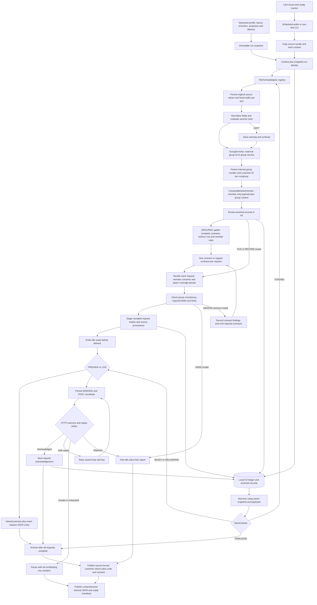

# How the current POC fits together

Start with the [developer walkthrough](developer-walkthrough-v2.md) for the code tour. The [runtime diagrams](runtime-diagrams-v2.md) show the calls between classes, and the [CSV walkthrough](csv-debug-walkthrough-v2.md) follows a record through the code. The [mapping guide](flexible-mappings-v2.md) explains the YAML settings.

Editable diagram: [architecture.mmd](architecture.mmd).

## Read the file, look up information, then build JSON

Each file adapter understands one kind of input syntax. It reads records without deciding where their fields belong in the outgoing JSON.

Named enrichers add information to those records. For consent, they call the group service first, then the member service. The configured projection—the instructions for building JSON—chooses the output fields, nested objects, collections and conversions. It also chooses whether to build requests from a whole file, one record or complete groups of records.

The generic mapping engine does not have consent targets, coverage paths or consent-manager paths built into Java.

## Save progress before sending

The application saves enriched records separately from completed request bodies. It prepares and checks the whole supported-size file before sending any upserts. Recovery uses the saved configuration, lookup results, JSON and references to the contributing source records.

Current saved projections use engine version 4. The old object-path mapper and consent-specific planner were removed. Runs saved with engine versions 1–3 need the earlier release.

This is a single-worker POC using H2 on disk. Whole-file mapping does not mean it can stream a file of any size. The receiving service still decides what counts as success, how partial failures work, how retries avoid duplicates and how conflicting updates are handled. Putting several changes in one JSON body does not make them one transaction.

## Keep complete contracts together

In `GROUPED` mode, `RequestBatcher` gathers all rows for a contract, even when they appear in different parts of the file. It checks row/member limits and puts either one contract or up to a configured number into a request. See [both JSON examples](contract-batching-v2.md).

The single-contract example creates `{contractId, consents}`. The other creates an array of those objects. Each consent identifies its member through the consent owner. A member can have several payer-consent groups, each with several coverages. The receiving service still needs to accept one of these formats.

The batcher chooses the rows for each request before the mapping engine builds its JSON. A HARD preparation error stops all sending. When configured, a MEDIUM error removes the affected contract before final batching, and a SOFT warning allows processing to continue.

Each saved request keeps the source-record references, body and retry key. Resume skips acknowledged requests. File-size limits still apply separately from request-size limits. Whole-file and per-record examples remain available for comparison.

## Write customer results and the IT report

The application saves original source records before changing or enriching them. Customer results use those records, with code and remarks added in the incoming format. They do not contain the consent JSON.

`ResultStore` saves originals, member/contract references and findings without duplicating them. `PreparationCoordinator` applies the error rules. `ServiceResultProcessor` matches saved service results to source records. `ResultPublisher` and `SourceResultWriter` write the customer file and a separate IT JSON report.

Each published result has a new revision filename and a ready manifest identifying it. Another process sends the customer file and IT email. Incomplete input and uncertain service outcomes do not produce an automatic final customer return. See [error handling](error-handling-v2.md).

## Look up the group before the member

`GroupEnricher` sends the external group ID to the group service. `GroupContextStore` saves its internal group number and customer ID for that run and group.

`ConsentMemberEnricher` then sends member demographics/identifiers plus those group values to the member service. That returns the contract, PIN and member GUID used to build consent JSON. Do not send payer fields, consent preferences, consent-target flags or the upsert body to the demographics service. See [lookup details](group-member-lookups-v2.md).
