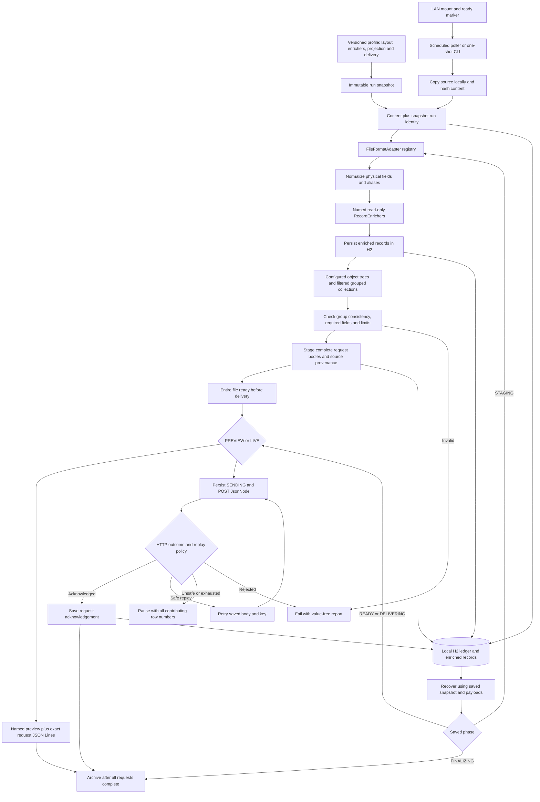

# Implemented architecture

The [developer walkthrough](developer-walkthrough.md) is the primary team guide. [Flexible mappings](flexible-mappings.md) documents the new generic projection strategy and its latest-sample examples.

Editable source: [architecture.mmd](architecture.mmd).

File syntax stays inside adapters. Optional named enrichers add source-side values without choosing output properties. Projection profiles select object structure, collection filtering/grouping, scalar conversions and FILE/RECORD request scope. No consent target, coverage or manager path is built into the generic projection engine.

Enriched rows and final request bodies are persisted separately. Preflight validates the entire bounded file before any upsert. Recovery reuses saved configuration, enrichment and payloads, with aggregate source provenance. Projection snapshots use engine version 4. The older object-path mapper and specialized consent planner have been removed; engine versions 1–3 require the previous release.

The implementation is a bounded single-worker POC with local H2. FILE scope demonstrates aggregation across rows, not arbitrary-volume streaming. The service still owns batch semantics, acknowledgement, idempotency and business-level conflict rules. A JSON envelope is not a distributed transaction.
