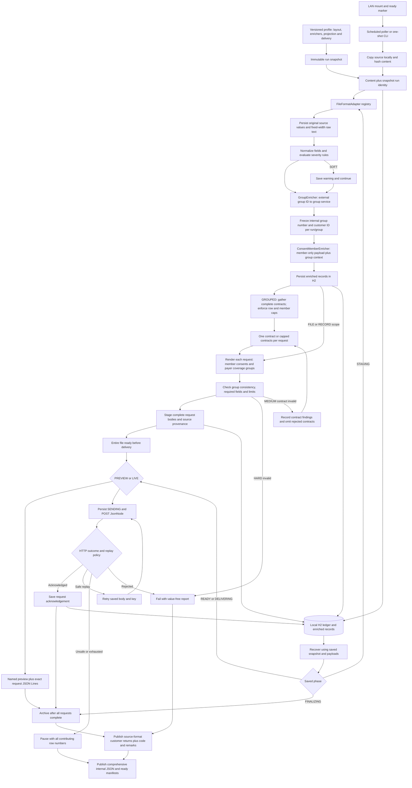

# Implemented architecture

See the [runtime sequence and class diagrams](runtime-diagrams.md) and [CSV debugger walkthrough](csv-debug-walkthrough.md) for detailed execution.

The [developer walkthrough](developer-walkthrough.md) is the primary team guide. [Flexible mappings](flexible-mappings.md) documents the new generic projection strategy and its latest-sample examples.

Editable source: [architecture.mmd](architecture.mmd).

File syntax stays inside adapters. Optional named enrichers add source-side values without choosing output properties. Projection profiles select object structure, collection filtering/grouping, scalar conversions and FILE/RECORD/GROUPED request scope. No consent target, coverage or manager path is built into the generic projection engine.

Enriched rows and final request bodies are persisted separately. Preflight validates the entire bounded file before any upsert. Recovery reuses saved configuration, enrichment and payloads, with aggregate source provenance. Projection snapshots use engine version 4. The older object-path mapper and specialized consent planner have been removed; engine versions 1–3 require the previous release.

The implementation is a bounded single-worker POC with local H2. FILE scope demonstrates aggregation across rows, not arbitrary-volume streaming. The service still owns batch semantics, acknowledgement, idempotency and business-level conflict rules. A JSON envelope is not a distributed transaction.

## Complete-contract request boundaries

[Contract batching](contract-batching.md) adds generic `GROUPED` scope: `RequestBatcher` gathers complete groups from interleaved rows, enforces per-contract row/distinct-member limits and packs one or up to N contracts into each request. Single mode emits `{contractId, consents}`; array mode emits a root array of those objects. Members are identified in each consent owner, and a member can have separate keyed payer consents with multiple coverages each. These wrappers are POC alternatives pending the endpoint contract.

Request partitioning happens before per-partition tree rendering. A later HARD preparation error blocks all delivery. Opt-in MEDIUM preparation handling isolates one contract before final batching; SOFT warnings continue. Source provenance is saved for each resulting request; acknowledged batches are skipped on resume while a failed batch retains its body and key. The file record/memory bound remains independent of the new outgoing-request bounds. Whole-file and per-record mappings remain available for comparison.

## Original-record result outboxes

The [result subsystem](error-handling.md) saves source records before normalization and preserves their source-format representation independently of consent JSON. HARD rejects a file, MEDIUM isolates contracts, and SOFT records nonblocking warnings. Opt-in scoped service responses can reject a member without rejecting its whole contract when identities are reliable.

`ResultStore` persists originals, identity indexes and deduplicated events; `PreparationCoordinator` applies policy; `ServiceResultProcessor` correlates persisted response issues; `ResultPublisher` uses `SourceResultWriter` to append customer code/remarks in the incoming format. It writes separate internal JSON with all findings. Immutable revisions and ready manifests are the handoff to outside customer-delivery/email processes. Incomplete sources and uncertain service outcomes do not publish an automatic customer return.

## Ordered group/member enrichment

GroupEnricher first resolves the file’s external group ID through the group-service port. GroupContextStore saves internal group number and customer ID per run/group. ConsentMemberEnricher then sends only a typed member demographic/identifier payload with that context to the member-service port. It receives the contract/PIN/member GUID identities used by JSON projection. No payer, consent preference, target flag or upsert object is sent to the demographics lookup. See [the full service contracts and recovery behavior](group-member-lookups.md).
