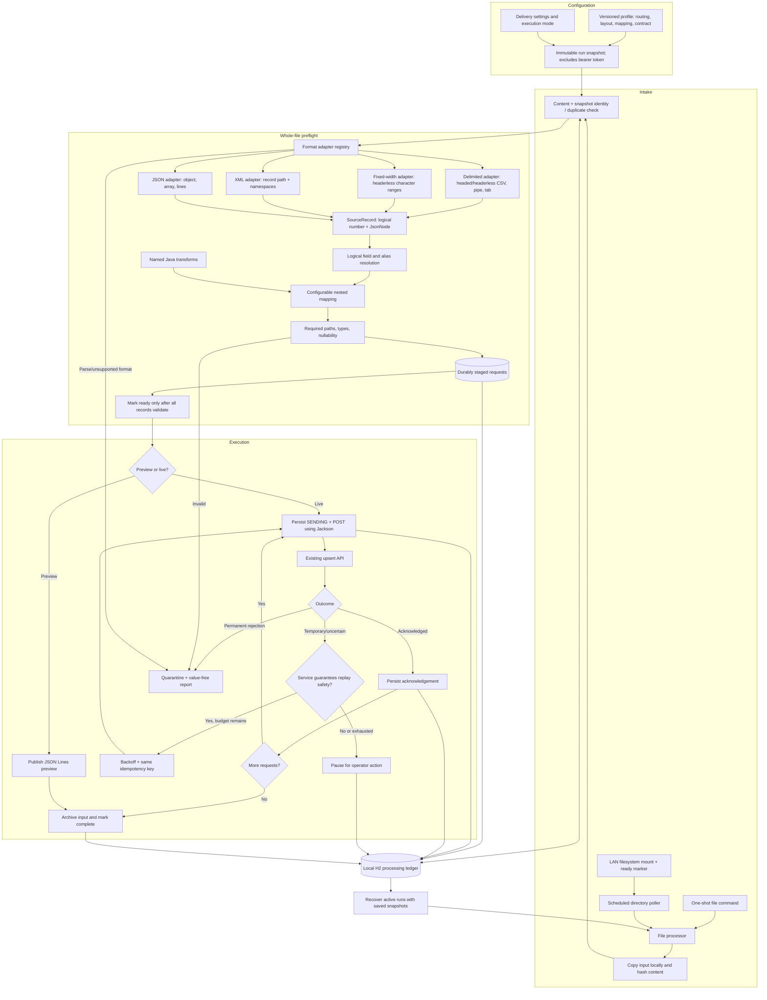

# Implemented architecture

Editable Mermaid source: [architecture.mmd](architecture.mmd).

The H2 ledger stores file-level state, immutable configuration snapshots, staged request payloads, attempts, and acknowledgements. Local source copies and previews live under the configured work directory. There is no JSON intermediate file in the live POST path.

The implementation deliberately uses a single worker and sequential delivery. It provides restart recovery and replay safeguards, not a distributed exactly-once transaction. Delimited, fixed-width, XML, and JSON parsers are implemented. Full JSON Schema validation, row aggregation, byte-oriented fixed-width layouts, mixed-content XML, envelope JSON record selection, and asynchronous API completion remain extensions once their contracts are known.
