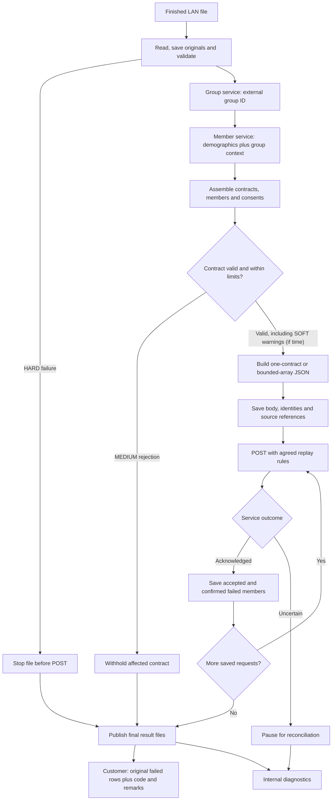

# January Delivery Plan Detailed

See the [January release class and sequence diagrams](january-release-diagrams.md) for the proposed classes, happy path, and error paths; optional scope remains marked for discussion.

## 1. Proposed boundaries

| Component | Owns | POC reference |
| --- | --- | --- |
| Intake worker | Finished-file detection, local staging and run identity | FileProcessor / DirectoryPoller |
| File adapter | Physical syntax and original-record capture | FileFormatAdapter implementations |
| Normalization | Producer names → consistent internal fields | SourceNormalizer |
| Group lookup | External group ID → internal group number/customer ID | GroupEnricher / GroupResolver |
| Member lookup | Member demographics/identifiers plus group context → member identity | ConsentMemberEnricher / MemberResolver |
| Consent assembler | Contract/member grouping, consent decisions and payer collections | PreparationCoordinator / projection examples |
| Payload builder | Agreed JSON field names, nesting and root wrapper | ProjectionEngine demonstrates configuration; small Jackson builders are the proposed initial production alternative |
| Delivery | Request limits, HTTP handling, acknowledgement and safe retry | UpsertClient / HttpUpsertClient |
| Results | Original-record customer returns and detailed IT diagnostics | ResultStore / SourceResultWriter / ResultPublisher |

Organize the contract, member, and consent data the same way inside the application. Then use two small pieces of code to create the JSON: one for sending a single contract and one for sending several contracts together. A setting determines which format to use.

If the receiving service needs a field added or moved, update the code that creates the JSON. The code that reads the files and calls the group and member services should stay the same.

## 2. First-release scope and acceptance

| Capability | Initial scope | Acceptance check |
| --- | --- | --- |
| Intake | One worker and a finished-file protocol for the configured LAN folder | A file still being written is not processed. |
| Formats | CSV only; other formats only when they become needed in a future release | Read representative files, including quotes, blanks and malformed records. |
| Original records | Retain source values and source-record references before normalization | Customer returns contain the original fields, not enriched consent JSON. |
| Group lookup | Update to our existing company group service (dncgrp endpoint) | Only external group ID is sent; incomplete group context should prevent member lookup. |
| Member lookup | Update to our demographics service (dmqmbr endpoint) | The request contains only member demographics/identifiers and resolved group context. |
| Contract assembly | Bring together all records for a contract and its members, even when they appear in different parts of the file. | Repeated information does not create duplicate consents or payer coverage records. Conflicting information is flagged. |
| Payer data | Support the agreed consent identity and coverage collection rules (see Tech Design Doc) | Multiple payer records are associated with the correct member and consent. |
| JSON candidates | Discussion needed --> Support sending one contract at a time or several contracts together, up to a configured limit. ? | Reviewed examples against the dmqmbr upsert service endpoints - should match the candidate service json schema |
| Limits per Service Call | Configure/Set limits on the number of contracts, members and payer coverage records, and the total amount of data sent in one call. | If a contract or group of contracts is too large, flag for handling rather than splitting its members or payer information across calls without an agreed rule. |
| Error scope | HARD file stop, MEDIUM contract rejection, SOFT warning (if we have time to do SOFT warning) | Other valid contracts continue when rules permit. |
| Service results | Use the contract number and member GUID returned by the service to match failures to the original file records. | When the service identifies a failed member, return only that member’s submitted records in the customer error file. |
| Support and Troubleshooting | Write logs, show processing counts and error-file locations, and provide a short guide for support. | Support can find a processing run, see which records were affected and what was sent, and determine whether processing succeeded, failed or needs attention. |

The POC uses an H2 database saved on disk, so processing status survives a restart. For production, we may want to choose another form of storage. We may be okay with H2 for January and then opt for a database or other alternative later down the road.

Start with one process handling files. If we later need several processes running at once, we’ll need a way to assign work so they don’t process the same files or contracts twice.

Start with one complete contract per request. Implement the bounded array option through the same assembler and delivery path. A contract that exceeds the agreed limits needs explicit rejection or a separately agreed split protocol; do not silently omit members or payer data.

## 3. Detailed processing flow

The diagram focuses on boundaries rather than every exception. Group/member lookup errors follow the current services contracts, and a group failure prevents that member call. MEDIUM rejections accumulate while other contracts continue; publish the final customer return when the run’s outcomes are known. SOFT warnings remain visible in the IT report (if time).

Persistence happens throughout intake and lookup as well as before POST. Save successful group context for the run and completed member resolutions where practical, then save the exact outgoing body before the network side effect. The POC shows these as separate checkpoints.

## 4. Discussion - need to agree on how the receiving service works

Before we finish building the adapter, agree with the receiving-service on these details:

| Topic | What we need to know |
| --- | --- |
| Identifying consents | How do we tell one consent from another, especially when a member has several payer consents? How do we find an existing consent’s GUID? |
| Updating coverage | Does the service add to existing coverage, replace it all, or require specific add/remove instructions? Does an empty list mean “remove everything” or “no changes”? |
| Partial success | If one item fails, does the service reject the whole request, the contract, the member or just that consent? |
| Identifying failures | What identifiers will the response include so we can find the original failed records? A member GUID alone cannot tell us which of that member’s coverage records failed. |
| Confirming completion | What response tells us the work is actually finished? “Request received” may not mean “changes saved.” |
| Retrying requests | If we send the same request again, how does the service prevent duplicate changes? How do we check what happened when we never received a response? |
| Request limits | How many contracts, members and coverage records can we send at once? How large can the JSON be? |
| JSON format | Which JSON structure will be accepted initially? What date formats should we use? How do we say “leave this unchanged” or “revoke this consent”? |
| Consent manager | How do we identify someone giving or managing consent on another member’s behalf? |

Work through realistic sample requests and responses together. Agree on the initial JSON format early. Keep the code that talks to the services and builds the outgoing JSON separate so later changes are easier to make.

## 5. Error files and partial results

| Situation | What the adapter does | What the customer receives | What IT receives |
| --- | --- | --- | --- |
| File cannot be prepared — HARD | Stops before sending any consent updates | Original records with code and remarks, if the file can be read completely | Why the file failed and which records were affected |
| One contract is invalid — MEDIUM | Skips that contract and continues with the others | That contract’s original records with code and remarks | What failed and which contract was rejected |
| Warning — SOFT | Continues processing | Warning records only if the agreed customer-return rules require them | The warning and affected records |
| Service confirms a member failed | Records the failure and keeps any confirmed successes | That member’s submitted original records with code and remarks | The request, member identifiers and affected source records |
| We cannot tell whether a request succeeded | Holds the affected work for review, or retries if the service supports safe retries | No final result claiming those records failed until we know what happened | What is uncertain and what needs to be checked |

Assumption: The customer error return file uses the **same file format as the input they sent**, with **code** and **remarks** added to each returned record. Agree on where those fields go (and for fixed-width files if ever they are needed, we will need to agree how many characters they occupy).

If a file is too malformed to read completely, keep the original for review. Do not return just the readable portion as though it represents the entire file.

The adapter writes the files. 
Need to flesh out the process that sends the customer file and emails the DBS IT report (TBD). 
Customer remarks should use agreed, understandable wording. 
DBS IT gets more technical detail, with credentials and sensitive response content excluded.

Discussion point --> **Stopping later does not undo earlier successful requests.** Keep those successes recorded. Never mark accepted records as failed because a later request failed.

## 6. Prove the complete flow works

Could use made-up test data with several contracts and multiple members per contract. 
Could put some records for the same contract in different places in the file.

1. Include provider consent changes, payer consent changes and records containing both.
2. Include multiple payer consents/coverages for one member.
3. Make one contract invalid and give another a warning that allows processing to continue.
4. Send the valid contracts using the agreed request format and limits.
5. Check that the customer gets the correct original failed records with code and remarks, and DBS IT gets all errors and warnings.
6. Have the test service reject a specific member. Check that the adapter handles the other members according to the agreed rules.
7. Stop the adapter after one request succeeds. Restart it and prove that the successful request is not sent again.
8. Simulate a request where the response is lost. Prove that we can check the outcome or safely resend the same request without duplicate changes.

Also test unreadable files, multiple possible member matches, missing group information, oversized requests and failures while writing result files.

Test realistic file sizes and document the largest file the January release supports (but we probably won't know this because I doubt we'll even have a file / partner onboarded by Jan)

## 7. Leave these out of the January release

- Several workers processing files at the same time.
- A configuration screen or a general-purpose mapping language.
- Files of unlimited size or combining unrelated files.
- Sending customer files or IT emails from inside the adapter.
- A general scheduling system or advanced dashboards.

The POC demonstrates possibilities. The January release needs to reliably handle the agreed input files, call the services correctly, produce accurate results and give support enough information to investigate problems.

Relevant POC guides: [code walkthrough](developer-walkthrough.md), [group/member lookup](group-member-lookups.md), [contract batching](contract-batching.md), [error/result handling](error-handling.md), and [implemented runtime diagrams](runtime-diagrams.md).
