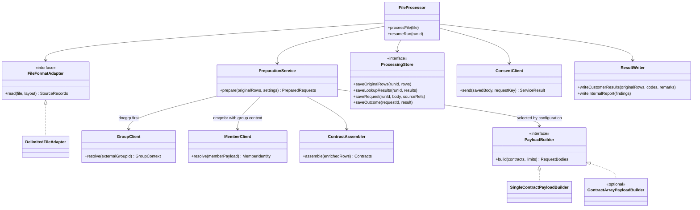
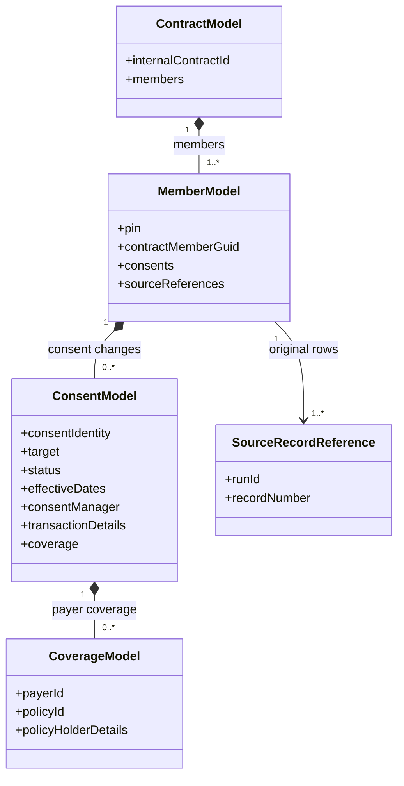
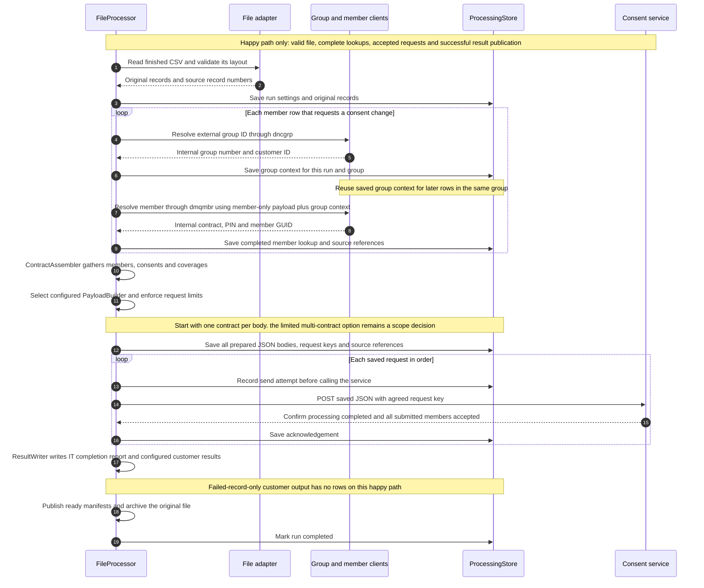

# January Release: Class and Sequence Diagrams

These diagrams describe the **proposed January release**, using the smaller design in the [overview](january-delivery-plan-overview.md) and [detailed plan](january-delivery-plan-detailed.md). Class names are suggested responsibilities, not a claim that these exact classes already exist in the POC. GroupClient calls dncgrp and MemberClient calls dmqmbr. The initial input is CSV. Multi-contract batches, SOFT warnings, MEDIUM contract-versus-member handling, and the extent of automatic recovery remain scope/contract decisions in the latest plans. The [POC runtime diagrams](runtime-diagrams.md) describe the current configurable implementation.

Start with the application classes and happy-path sequence for the team walkthrough. Use the data model and error-path sequence when discussing implementation and acceptance tests. Sequence diagrams group related clients into one participant to keep the drawings readable; their group/member call order is still explicit.

## Application classes

FileProcessor coordinates the run. PreparationService normalizes and validates records, resolves group/member identities, gathers complete contracts, and selects the JSON builder. ProcessingStore uses company-approved durable storage. FileFormatAdapter and PayloadBuilder keep file reading and JSON construction independent.

January uses CSV through DelimitedFileAdapter. Other file formats stay outside the initial scope; the adapter interface leaves room for them later. ResultWriter owns same-format UCD customer returns and the separate DBS IT report; an outside process handles sending/email.

Editable Mermaid source: [january-release-classes.mmd](diagrams/january-release-classes.mmd).

## Internal data model

This is how the application organizes information internally. It is **not the outgoing API JSON schema**. A builder can turn these members and their consents into the receiving service's agreed field names and nesting.

A member can have several consents, including several distinct payer consents where the service supports that model. Each payer consent can have several coverages. Source references point to separately saved original records, so result files can return the correct source rows.

Editable Mermaid source: [january-release-data-model.mmd](diagrams/january-release-data-model.mmd).

## Sequence: happy path only

Assume all input and contracts are valid, both lookup services return complete identities, all consent requests are accepted, and output files can be written. There are no error or alternate branches in this sequence. It shows LIVE delivery; PREVIEW omits the consent POSTs.

Editable Mermaid source: [january-release-sequence-happy.mmd](diagrams/january-release-sequence-happy.mmd).

## Sequence: errors and recovery

The same flow illustrates HARD file stops, the alternative MEDIUM boundaries, optional SOFT warnings, service member/contract results, uncertain sends and result-file failures. Branches marked optional or dependent on agreement are discussion items, not committed January features. A member-level rejection requires a complete, agreed response identifying that member reliably. Unknown outcomes pause processing rather than inventing customer failures.

```mermaid
sequenceDiagram
    autonumber
    participant P as FileProcessor
    participant A as PreparationService
    participant S as ProcessingStore
    participant E as Group, member and consent services
    participant R as ResultWriter
    P->>S: Save run and available original records
    P->>A: Read and validate the complete input
    break HARD file or parsing failure
        A-->>P: File cannot proceed
        P->>S: Save HARD findings and failed-file status
        P->>R: Write IT report and eligible original-record return
        Note over P,R: No consent POST. incomplete parsed input is not published as a complete customer return
    end
    loop Each contract being prepared
        P->>A: Validate and resolve its member rows
        A->>S: Look for saved group context for this run
        S-->>A: Saved context or no previous resolution
        opt Group context is not already saved
            A->>E: dncgrp lookup with external group ID only
            E-->>A: Complete group context or lookup failure
        end
        alt Group resolution failed or incomplete
            Note over A,E: Do not call the member service for this failed lookup
        else Group context available
            A->>S: Save newly resolved internal group number and customer ID
            A->>E: dmqmbr lookup with member-only payload plus group context
            E-->>A: Member identity or lookup failure
        end
        alt HARD lookup or contract policy
            A-->>P: File-level failure
            P->>S: Save HARD findings
            P->>R: Write failure results
            break Stop this file before delivery
                Note over P,E: No consent POST for this file
            end
        else MEDIUM contract rejection, if this boundary is selected
            A-->>P: Reject this complete contract
            P->>S: Save findings and all affected original row references
            Note over P,S: Continue preparing the other contracts
        else MEDIUM member rejection, if selected and reliably identified
            A-->>P: Reject only the identified member
            P->>S: Save that member's affected original row references
            Note over P,S: Retain other members only under the agreed partial-contract rules
        else SOFT warning, if included in January scope
            A-->>P: Contract remains eligible, with warning
            P->>S: Save warning without rejecting the contract
        else Valid contract
            A-->>P: Contract ready for JSON assembly
        end
    end
    P->>A: Build one-contract requests from eligible data under the agreed error policy
    A-->>P: JSON bodies within agreed limits. multi-contract arrays are optional scope
    P->>S: Save all request bodies, stable keys and source references
    Note over P,S: Any remaining HARD preparation error stops delivery. an empty eligible set produces no POST
    loop Each saved request that is not already acknowledged
        loop Attempt same request until acknowledged, rejected or paused
        P->>S: Record attempt before POST
        P->>E: Send saved JSON and agreed request key
        alt All submitted members accepted
            E-->>P: Confirmed completed success
            P->>S: Save acknowledgement
        else Confirmed member or contract rejection with usable IDs
            E-->>P: Complete results identify accepted and failed work
            P->>S: Save acknowledgement and scoped outcomes together
            Note over P,R: Member rejection selects that member's submitted rows. contract rejection selects that contract's rows
        else Known permanent request rejection or HARD service stop
            E-->>P: Confirmed rejection
            P->>S: Save failure and stop remaining requests
            P->>R: Write failure results, excluding earlier accepted rows
            break Stop further delivery
                Note over P,E: Earlier acknowledgements cannot be rolled back
            end
        else Timeout, lost response or temporary transport failure
            E-->>P: Request outcome is not confirmed
            P->>S: Save uncertain or retryable outcome
            alt Automatic replay is included, agreed safe, and attempts remain
                P->>P: Wait before the next permitted attempt
                Note over P,E: Next attempt uses the same saved body and key. remain on this request until its outcome is resolved
            else Replay is unsafe or retry limit is reached
                P->>S: Pause run for reconciliation
                P->>R: Write internal hold report
                break Await reconciliation
                    Note over P,R: No final customer rejection is inferred from an uncertain send
                end
            end
        else Incomplete response, unknown IDs or unrecognized result codes
            E-->>P: Results cannot be matched reliably
            P->>S: Preserve outcome and pause for reconciliation
            P->>R: Write internal hold report
            break Await a reliable decision
                Note over P,R: Do not guess which member failed or resend acknowledged work
            end
        end
        end
    end
    P->>S: Save finalizing status
    P->>R: Publish customer and IT result files
    alt Result files written successfully
        R-->>P: Ready manifests point to completed files
        P->>S: Mark completed or completed with rejections
    else Result-file write failure
        R-->>P: Output is not ready
        P->>S: Keep recoverable finalization state
        Note over P,R: Retry result publication after repair. do not repeat acknowledged consent POSTs
    end
```

Editable Mermaid source: [january-release-sequence-errors.mmd](diagrams/january-release-sequence-errors.mmd).

## Rules to agree before release

- Resolve external group ID first. Pass the returned internal group number/customer ID with the member-only demographics request; keep consent and payer data out of that lookup.
- Build and validate eligible data before the first consent POST. HARD preparation failure stops the file. Decide whether MEDIUM rejects a contract or a reliably identified member, and whether SOFT warnings are included in January. Do not infer member-only failure without adequate identity and agreed partial-processing rules.
- Start with one contract per request. An array of contracts up to a configured limit is an optional scope decision. Keep each contract's eligible changes together; excluding a rejected member requires the agreed partial-processing rule. Never silently omit members/coverage or split data just to fit a limit. The receiving-service team must accept the JSON wrapper.
- Save original records, lookup progress, request bodies, keys and outcomes. If restart/resume is included, skip acknowledged POSTs and restore their saved member/contract findings.
- Member/contract business outcomes require an agreed response protocol. An HTTP success status alone does not define partial success or batch atomicity.
- Treat an uncertain send as needing investigation. Automatic retry/reconciliation is a scope decision and requires agreed idempotency rules. Any permitted retry uses the same body/key and remains on that request until resolved or paused.
- Customer results contain original affected records plus code and remarks in the incoming format. DBS IT receives all recorded hard/medium findings and any SOFT warnings included in scope. Publish only completed, eligible files through ready manifests; outside processes handle transmission/email.
- A late LIVE failure cannot undo earlier accepted work. Preserve those successes. Unreadable input, uncertain results and incomplete customer returns need explicit review rather than a misleading failed-member file.

No parallel workers, configuration UI, general mapping language or unlimited-file streaming is required by this proposed initial design. Persistence technology, service contracts and supported limits remain implementation decisions to confirm with the deployment and service teams.

## How these names relate to the POC

| Suggested release responsibility | Existing POC starting point |
| --- | --- |
| PreparationService | PreparationCoordinator, SourceNormalizer and the lookup chain |
| GroupClient / MemberClient | GroupResolver / MemberResolver and their configured adapters |
| ContractAssembler / PayloadBuilder | Contract grouping and JSON examples in ProjectionEngine; the release can use smaller typed builders |
| ConsentClient | UpsertClient / HttpUpsertClient |
| ProcessingStore | ProcessingLedger plus saved source, lookup and result state |
| ResultWriter | ResultPublisher / SourceResultWriter |

These are responsibility boundaries, not a requirement to rename existing classes or rewrite tested adapters.
