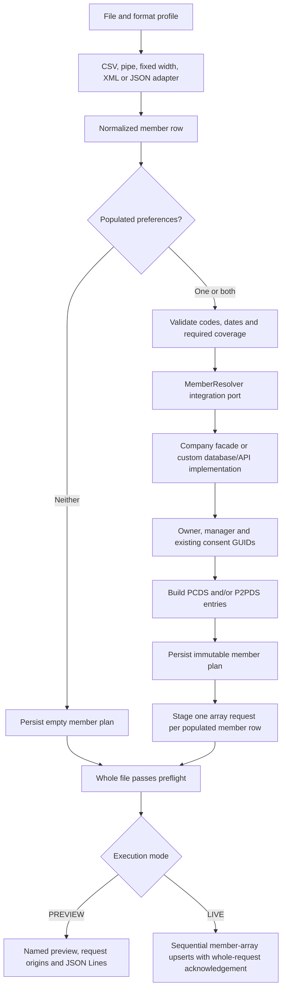

# CMS Interop consent ingestion

This is the implemented consent POC based on the supplied file fields and sample upsert objects. It does not claim to implement a published CMS file specification. The company's member lookup protocol and final consent API schema still need confirmation.

## Quick start in Git Bash

Run from the repository root, with a JDK available through `JAVA_HOME` and `PATH`:

```bash
./gradlew test bootJar
java -jar build/libs/fileadapter-0.1.0.jar \
  --spring.profiles.active=consent-demo \
  --ingestion.file=examples/consent/consent.csv
```

No lookup server is needed for this preview. The explicit `consent-demo` Spring profile uses synthetic member fixtures, disables polling, selects PREVIEW and writes to `var-consent-demo`. It supplies a fixed timestamp and transaction identifier for comparisons. Normal runs use HTTP lookup and capture the UTC timestamp once per completed member plan.

Inspect `var-consent-demo/preview/<run-id>/consent.csv.preview.json`. It names the file, format, profile and run, includes the actual bodies in `requests`, and pairs each body with its member row and target in `requestDetails`. `requests.jsonl` contains only POST bodies. Do not send the preview wrapper to the consent service.

Five sample member rows produce four HTTP request arrays containing six consent entries:

| Source row | Provider preference | Payer preference | Requests |
| --- | --- | --- | --- |
| 1 | RVOKE | GRANT | One array: PCDS insert and P2PDS update |
| 2 | GRANT | blank | One array: PCDS only |
| 3 | blank | RVOKE | One array: P2PDS only, different manager |
| 4 | GRANT | GRANT | One array: PCDS and P2PDS |
| 5 | blank | blank | No change, no lookup, no POST |

The fixture uses a three-character alphanumeric PIN (`00A`) and a different manager PIN (`XYZ`) to demonstrate that these identifiers are strings, not integers. All examples and lookup results are synthetic.

## Every input format

Each command uses the same business planner. The formats differ only in the parser profile:

```bash
for file in consent.csv consent-noheader.csv consent-header.psv consent-noheader.psv \
            consent.fw consent.xml consent-array.json consent.jsonl consent-object.json; do
  java -jar build/libs/fileadapter-0.1.0.jar \
    --spring.profiles.active=consent-demo \
    --ingestion.file="examples/consent/$file" || break
done
```

All five-member examples produce the same four array requests containing six entries. `consent-object.json` contains only row 1 and produces one array request containing two entries. Expected outputs are in `examples/consent/expected-requests.jsonl` and `expected-request-details.json`. The [combined request](../examples/consent/expected-combined-request.json) shows both entries in a single POST body. The [provider-only array](../examples/consent/expected-provider-request.json) and [payer-only array](../examples/consent/expected-payer-request.json) show the corresponding one-entry shapes. The headerless files use the supplied 30-field order. Fixed width uses the illustrative ranges in `fixed-width-layout.json`, totaling 544 Unicode code points per line. These ranges are examples, not an agreed production layout. XML selects `/members/member`. JSON array, object, and Lines boundaries are explicit profile settings.

Use `--ingestion.profile-id=cms-consent-csv-v1` for a differently named headed CSV. Automatic matching accepts `consent.csv` and `consent-header*.csv`; change filename patterns for the actual feed. Header matching is case-sensitive. The supplied trailing comma after `PAYER_COVERAGE_TYPE` is treated as punctuation in the field list, not a 31st column. An actual empty CSV header is rejected.

`python scripts/generate_consent_examples.py` regenerates the synthetic data, expected bodies and layout reference using the standard Python library. Python is optional for the Java application and fixture previews. It is needed only for this generator and the local mock server.

## Implemented pipeline



`FileFormatAdapter` remains responsible for syntax. `SourceNormalizer` resolves physical fields and aliases. `ConsentRequestPlanner` validates consent intent, calls `MemberResolver`, assembles nested request objects and freezes them through `ConsentPlanStore`. Jackson serializes the objects. Generic employee profiles continue using `ConfigurableRequestMapper` and `RequestValidator`.

Provider precedes payer within the member array. Each nonempty member plan becomes one staged array request and one POST. Request numbers are sequential across the file, while source record numbers identify member rows. Delivery keys use `<run-id>:<request-number>`, so both consent entries share the member request’s recovery identity. A one-entry body is still an array. No-change rows are not posted.

## Contract assumptions in this version

| Topic | Implemented rule |
| --- | --- |
| Target | Configurable `PCDS` for provider, `P2PDS` for payer |
| Preferences | Explicit case-insensitive code map. The example accepts GRANT and RVOKE only |
| Blank or null preference | No change for that target. A missing preference field fails validation |
| Unknown preference | Reject the entire file before sending any upsert |
| Dates | Strict configurable input pattern `uuuu-MM-dd`, output ISO `yyyy-MM-dd`. Use `MM/dd/uuuu` for US input |
| Insert/update | Null `consentGuid` for insert, existing GUID supplied by lookup for update |
| Owner | Resolved internal contract, three-character PIN and opaque member GUID. Never derive these from external IDs |
| Manager | Explicitly resolved independently of owner, even when both identities happen to be the same |
| Payer entry | One P2PDS entry per row. Include coverage when coverage fields are supplied; otherwise use the general payer shape. Provider has no coverage |
| Transaction details | Top-level sibling of `coverage`. Owner and manager both include contract, PIN and GUID |
| End date | Explicit null. No dedicated consent end date exists in the supplied input |
| Coverage dates | Payer policy effective/cancel dates do not set consent effective/end dates |
| Relationship | Explicit code map to SELF, SPOUSE, DEPENDENT or OTHER. Assumes RELATIONSHIP_CODE also describes relationship to policy holder |
| Metadata | Configured source system/transaction identifier. UTC creation timestamp captured once per member plan unless supplied in config |
| Delivery | One HTTP POST per nonempty member array, containing PCDS, P2PDS, or both. Never post separate target objects |

The corrected request envelope is a JSON array. The two supplied P2PDS objects are alternative payer shapes, not two entries for the same row. This implementation uses the resolved owner contract, PIN and GUID for both targets, and keeps transactionDetails at entry level alongside coverage. Confirm whether PIN should be omitted for the coverage-specific owner shape in the final schema.

When both preferences are populated, both targets are upserted, even if one value already matches the service. This version does not infer change from current state. If the feed always supplies both values but intends only one change, agree on change indicators or a current-state comparison rule before integration.

All relevant intent and payer validations run before lookup. When coverage is present, payer requires `PAYER_ID`, `PAYER_POLICY_ID` and a mapped relationship. Coverage presence means at least one mapped coverage field (payer ID, policy ID, group number or subscriber name/gender/DOB) is nonblank; partial coverage fails rather than silently degrading to the general shape. When every mapped coverage field is blank/null, emit one general P2PDS entry without coverage. Other coverage fields are nullable strings, including optional subscriber DOB after date validation. Member lookup criteria require external contract, relationship, first/last name and DOB for every emitted intent. A provider-only row does not require payer details or validate unused payer dates. A row with both preferences blank requires neither lookup nor member identity validation.

## Field disposition

| Input field | Use |
| --- | --- |
| EXTERNAL_CONTRACT_ID | Lookup criteria, never copied as internal contract |
| RELATIONSHIP_CODE | Lookup criteria and configured relationship-to-policy-holder translation |
| LAST_NAME | Member lookup criteria |
| FIRST_NAME | Member lookup criteria |
| MIDDLE_NAME | Optional member lookup criteria |
| GENDER_CODE | Optional member lookup criteria |
| DATE_OF_BIRTH | Required member lookup criteria, normalized to ISO date |
| EXTERNAL_GROUP_ID | Optional member lookup criteria |
| PROVIDER_CLINICAL_CONSENT_EFFECTIVE_DATE | PCDS effectiveDate, required when preference populated |
| PROVIDER_CLINICAL_CONSENT_PREFERENCE | PCDS consentStatus through explicit map |
| PAYER_CONSENT_PREFERENCE_EFFECTIVE_DATE | P2PDS effectiveDate, required when preference populated |
| PAYER_CONSENT_PREFERENCE | P2PDS consentStatus through explicit map |
| PAYER_NAME | Retained in original input, no target path supplied |
| PAYER_ADDRESS_1 | Retained in original input, no target path supplied |
| PAYER_ADDRESS_2 | Retained in original input, no target path supplied |
| PAYER_CITY | Retained in original input, no target path supplied |
| PAYER_STATE | Retained in original input, no target path supplied |
| PAYER_ZIP | Retained in original input, no target path supplied |
| PAYER_ID | coverage.payerId and optional lookup criteria |
| PAYER_POLICY_ID | coverage.otherPayerMemberId and optional lookup criteria |
| PAYER_GROUP_NUMBER | coverage.groupNumber |
| PAYER_SUBSCRIBER_LAST_NAME | coverage.policyHolderLastName |
| PAYER_SUBSCRIBER_FIRST_NAME | coverage.policyHolderFirstName |
| PAYER_SUBSCRIBER_MIDDLE_NAME | coverage.policyHolderMiddleName |
| PAYER_DATE_OF_BIRTH | coverage.policyHolderDateOfBirth, normalized ISO when present |
| PAYER_GENDER_CODE | coverage.policyHolderGender |
| PAYER_EFFECTIVE_DATE | Retained in original input, no agreed coverage date target |
| PAYER_CANCEL_DATE | Retained in original input, no agreed coverage date target |
| PAYER_PLAN_TYPE | Retained in original input, no target path supplied |
| PAYER_COVERAGE_TYPE | Retained in original input, no target path supplied |

Unused fields are retained in the staged/archived source, not added speculatively to the API body. If XML represents a field as an attributed or nested object, use `layout.fields` JSON Pointer selectors to extract its string. Consent input values must be strings or null to preserve identifiers and avoid format-dependent coercion.

## Request arrays and general payer example

`requests` in the preview is an array of POST bodies. For consent files, each POST body is itself an array, for example `requests[0]` contains the two consent entries for member row 1. `requestDetails` supplies `sourceRecordNumber`, `consentTargets` and `consentEntryCount` for that whole POST. `requests.jsonl` has one complete array per line. New consent preview source metadata includes engineVersion, consentRuleVersion and requestBodyShape=MEMBER_CONSENT_ARRAY to distinguish the corrected format from historical split-object previews.

The general payer example has no mapped coverage values:

```bash
java -jar build/libs/fileadapter-0.1.0.jar \
  --spring.profiles.active=consent-demo \
  --ingestion.file=examples/consent/consent-object-payer-general.json
```

Compare its one-entry array with [the expected general payer request](../examples/consent/expected-payer-general-request.json). The application never generates both a general and coverage-specific P2PDS entry for the same member row.

## Member enrichment integration

`MemberResolver` is the extension port. The default `ConfiguredMemberResolver` implements a **proposed facade protocol**, not a discovered company API. Replace it with the actual integration, or implement a facade that composes the required company calls/queries. When replacing the Spring bean, remove the default component or choose your implementation explicitly with `@Primary`.

POST `${CONSENT_LOOKUP_URL}` with this shape:

```json
{
  "EXTERNAL_CONTRACT_ID": "SYN-1001",
  "RELATIONSHIP_CODE": "SELF",
  "LAST_NAME": "Example",
  "FIRST_NAME": "Alex",
  "MIDDLE_NAME": "Q",
  "GENDER_CODE": "F",
  "DATE_OF_BIRTH": "1980-01-02",
  "EXTERNAL_GROUP_ID": "SYN-GROUP",
  "PAYER_ID": "SYN-PAYER",
  "PAYER_POLICY_ID": "SYN-POL-1001",
  "providerTarget": "PCDS",
  "payerTarget": "P2PDS",
  "resolveProvider": true,
  "resolvePayer": true
}
```

Require HTTP 200 with exactly one resolved identity set:

```json
{
  "owner": {"contract":"990000001","pin":"001","contractMemberGuid":"SYN-MEMBER-1"},
  "manager": {"contract":"990000001","pin":"001","contractMemberGuid":"SYN-MEMBER-1"},
  "providerConsentGuid": null,
  "payerConsentGuid": "SYN-CONSENT-20001"
}
```

The facade must match members uniquely, determine who may act as manager, and resolve current consent GUIDs for the requested targets (including correct payer/policy scope). HTTP errors, no unique match, null identity or invalid PIN fail preflight. No arbitrary first-result match, fabricated identifiers or owner-as-manager fallback exists. Lookup calls must be read-only despite POST transport. The worker does not create member/consent identities during lookup and does not automatically retry lookup failures. Correct the cause and submit a new version/input run; FAILED runs are not resumed. If an identical FAILED run needs to be reprocessed after a transient lookup outage, deliberately bump the consent rule `version` so a new run ID is created, then submit it again.

`CONSENT_LOOKUP_BEARER_TOKEN` authenticates lookup. `UPSERT_BEARER_TOKEN` independently authenticates consent delivery. Both are read at runtime and excluded from persisted snapshots. Never put tokens in endpoint URLs or fixture values.

## Local HTTP demo

This optional demo exercises HTTP lookup and actual POST delivery without company services. Start a separate Git Bash terminal:

```bash
python scripts/mock_consent_services.py
```

Then, in the repository root of another terminal:

```bash
export CONSENT_LOOKUP_URL='http://127.0.0.1:8082/members/resolve'
export UPSERT_URL='http://127.0.0.1:8082/consents/upsert'
export CONSENT_SOURCE_TRANSACTION='synthetic.demo'
export CONSENT_SOURCE_DATETIME='2026-10-27T12:00:00Z'
java -jar build/libs/fileadapter-0.1.0.jar \
  --ingestion.file=examples/consent/consent.csv \
  --ingestion.work-directory=./var-consent-live-demo \
  --ingestion.mode=LIVE --ingestion.poll-enabled=false
```

Omit `--spring.profiles.active=consent-demo` for HTTP delivery. LIVE explicitly refuses fixture lookup. The local receiver writes `var-consent-mock/received.jsonl`. Its idempotency memory lasts only for that Python process. It is a synthetic demonstration, not a production service or schema validator.

For partial-success recovery, start the mock with `--fail-once-target P2PDS`. Use a fresh work directory and add `--ingestion.delivery.replay-safe=true --ingestion.delivery.max-attempts=1`. The first array containing both provider and payer consent pauses as one request. Keep the mock running, then resume with the logged run ID:

```bash
java -jar build/libs/fileadapter-0.1.0.jar \
  --ingestion.work-directory=./var-consent-live-demo \
  --ingestion.resume=RUN_ID --ingestion.poll-enabled=false
```

The saved replay-safe settings apply to resume. Acknowledged member arrays are skipped. A retried array retains all of its original entries. This replay-safe flag is appropriate only for the local mock exercise or a real service with an agreed idempotency guarantee.

## Recovery and persistence

New consent snapshots use engine version 3 and rules version cms-consent-v2. Version 1 employee snapshots still load. Historical version 2 consent previews remain readable, but unfinished version 2 LIVE runs pause before any legacy object POST. Reconcile any previous effects and submit a new array run; do not silently merge or replay the old target requests. `Profile.consent` holds immutable business rules and lookup settings, so changing code maps, target codes or the configured lookup URL changes run identity. Credentials are excluded. Changing remote lookup data alone does not create a new run or reprocess completed content.

H2 stores a serialized member plan keyed by `(run_id, source_record)` after validation and enrichment. Each plan contains zero, one or two final consent entry objects. The processor wraps a nonempty plan as a single array POST body and persists it as one ledger request. If staging is interrupted, existing plans are reused with their original identities, GUIDs and timestamp. A crash before a member plan is saved may repeat its read-only lookup. Once READY, delivery and resume read only staged bodies and never call lookup again. There is no transaction across remote lookups, local storage and the consent service.

All member rows must pass parsing, lookup and request assembly before any consent POST. A later invalid member prevents every upsert from that file even if earlier requests have been staged. An entirely no-change file succeeds with zero requests. An empty/header-only file still fails.

Error reports add explicit `sourceRecordNumber` and, for delivery failures, `requestNumber`; the legacy `recordNumber` is retained. Acknowledgement applies to the member array. The client does not independently acknowledge or retry its consent entries. A single POST does not prove that the service applies the entries atomically: an agreed success status must mean all submitted entries completed, or the client needs the service’s item-result protocol. If the service partially applies an array before a timeout, replay requires whole-request idempotency or service-supported reconciliation. Replays require the same service-side idempotency guarantees as the generic pipeline. A run ID prevents exact content/configuration duplicates within the retained local ledger, not duplicate business events across different files. Existing GUIDs can become stale between enrichment and delivery; concurrency, uniqueness/upsert rules and reconciliation belong in the service contract.

Inputs, resolved plans, fixtures, snapshots, previews, captures and archived files may hold member data in an actual deployment. Logs/error reports avoid raw member values and HTTP bodies. Use the company's storage, access, retention and transport controls for those artifacts. Commit only synthetic examples.

## Decisions needed with the service team

Confirm preference source codes and blank semantics, relationship-code meaning, input/output date formats, required coverage fields for revocation, GUID lookup and payer/policy uniqueness, manager resolution/authorization, where transaction details belong, end-date semantics, and target paths for payer name/address/plan/coverage dates. Confirm whether an existing coverage record needs its own ID and how concurrent consent changes are handled. Publish the final OpenAPI/JSON Schema and exact lookup API contracts before connecting production data.
