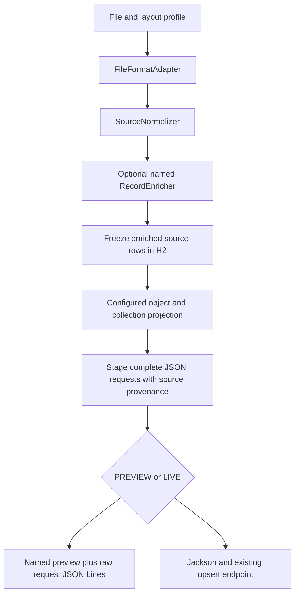

# FileAdapter: developer walkthrough

This is a proof of concept for the adapter pattern and flexible file-to-JSON mapping. The latest consent sample is the worked example, not a schema embedded in the generic processing engine.

Start with [flexible-mappings.md](flexible-mappings.md) for the complete configuration vocabulary and runnable variants. The [working YAML](../src/main/resources/application-flexible-demo.yml) is the primary mapping example. The older specialized consent implementation and PowerPoint are historical compatibility examples.

## 1. Four responsibilities

| Responsibility | Extension or configuration | Owns |
| --- | --- | --- |
| File syntax | `FileFormatAdapter` | Reading CSV, pipe, fixed width, XML or JSON into records |
| Business enrichment | Named `RecordEnricher` | Read-only lookup and calculated values |
| JSON shape | `ProjectionEngine` plus profile templates | Fields, nesting, literals, filtered/grouped arrays and request scope |
| Delivery/recovery | `FileProcessor`, ledger and `UpsertClient` | Durable staging, HTTP, acknowledgement and replay policy |

A new CSV header does not require an HTTP change. Moving `consentManager` does not require a parser change. A different lookup API belongs in an enricher rather than a file adapter. Another domain can use the same engine without any consent plugin.



The whole file must pass parsing, enrichment and projection before any upsert. Group conflicts or invalid later records block every request. Read-only lookups for earlier rows may already have occurred.

## 2. The latest sample

The supplied [CONSENT JSON ARRAY.txt](../examples/json-sample/CONSENT%20JSON%20ARRAY.txt) has a descriptive heading, then this target model:

- Root object with a `consents` array, which can contain multiple members.
- Provider PCDS entries with `coverage: []`.
- One payer P2PDS entry per configured member group, with a `coverage` array containing multiple payer/policy records.
- `consentManager` beside `transactionDetails` inside each entry.
- Per-entry metadata, including different source systems and the supplied timestamp string format.

The sample mapping reproduces that exact JSON body after removing the heading. Three flat rows describe two members: the second member repeats with a different payer. Configuration coalesces repeated provider data and groups both coverages under the same payer consent.

The actual complete body is [expected-envelope.json](../examples/flexible/expected-envelope.json). The target includes two PCDS entries and one P2PDS entry containing two coverages. The grouping and shape are mapping choices, not hard-coded consent branches in `ProjectionEngine`.

FILE scope is chosen for this example to demonstrate a multi-member request. The service's actual batch limit, merge/replace semantics for coverage, response format and transaction guarantees remain integration decisions.

## 3. Code tour

| File | What to inspect |
| --- | --- |
| [Profile](../src/main/java/com/jenbrick/fileadapter/config/Profile.java) | Independent layout, legacy mappings and optional projection |
| [ProfileCatalog](../src/main/java/com/jenbrick/fileadapter/config/ProfileCatalog.java) | Routing, startup validation and selection of mapping strategy |
| [FileFormatAdapter](../src/main/java/com/jenbrick/fileadapter/source/FileFormatAdapter.java) | Syntax-only extension contract |
| [SourceNormalizer](../src/main/java/com/jenbrick/fileadapter/source/SourceNormalizer.java) | Physical names/JSON Pointers mapped to logical fields |
| [Projection](../src/main/java/com/jenbrick/fileadapter/projection/Projection.java) | Small declarative template model |
| [ProjectionEngine](../src/main/java/com/jenbrick/fileadapter/projection/ProjectionEngine.java) | Tree rendering, collection filters, grouping and conflict detection |
| [MappingValues](../src/main/java/com/jenbrick/fileadapter/mapping/MappingValues.java) | Shared defaults, transforms, null/blank and code translation semantics |
| [RecordEnricher](../src/main/java/com/jenbrick/fileadapter/projection/RecordEnricher.java) | Named business extension independent of output structure |
| [ConsentMemberEnricher](../src/main/java/com/jenbrick/fileadapter/projection/ConsentMemberEnricher.java) | Example lookup adapter adding `resolved` values |
| [EnrichedRecordStore](../src/main/java/com/jenbrick/fileadapter/projection/EnrichedRecordStore.java) | Frozen enriched values for interrupted preflight |
| [FileProcessor](../src/main/java/com/jenbrick/fileadapter/processing/FileProcessor.java) | Parse/enrich/project/stage lifecycle and delivery |
| [ProcessingLedger](../src/main/java/com/jenbrick/fileadapter/processing/ProcessingLedger.java) | Payloads, multiple source origins, attempts and acknowledgement |
| [PreviewWriter](../src/main/java/com/jenbrick/fileadapter/processing/PreviewWriter.java) | File-labelled previews and aggregate provenance |
| [HttpUpsertClient](../src/main/java/com/jenbrick/fileadapter/delivery/HttpUpsertClient.java) | Generic JsonNode transport and response classification |

The optional old `ConfigurableRequestMapper` handles scalar-to-object-path mappings, and `ConsentRequestPlanner` preserves older consent snapshots. Neither determines the new configurable projection shape.

## 4. Configuration model

Each template node selects exactly one constructor:

| Constructor | Example | Result |
| --- | --- | --- |
| `source` | `{ source: FIRST_NAME, transforms: [trim] }` | Mapped source/enriched value |
| `literal-json` | `{ literal-json: '[]' }` | Typed constant, empty array/object or null |
| `object` | Named child nodes | JSON object |
| `array` | Collection rules with `item` templates | JSON array |

Arrays can filter source rows and group them before projecting an item. Nested collections operate on the parent group's rows. In the consent example:

```yaml
array:
  - where: { source: PROVIDER_CLINICAL_CONSENT_PREFERENCE, present: true }
    group-by: [resolved.owner.contractMemberGuid]
    item:
      object:
        consentTarget: { literal-json: '"PCDS"' }
        consentOwner: { source: resolved.owner, required: true }
        coverage: { literal-json: '[]' }
```

This is an excerpt, not the complete consent mapping. The full YAML includes status/date conversion, manager, metadata and nested payer coverage collections.

All mapped scalar values in a group must agree after conversion. Conflicting dates, statuses, identities or other mapped values fail preflight. Identical duplicate rows can coalesce when group keys match. Coverage deduplication uses the example's payer ID and policy ID keys; configure the approved business keys when known.

`scope: FILE` assembles one bounded aggregate request. `scope: RECORD` maps each input record separately. `skip-when-empty` can suppress a request with an empty result collection. `input-contract` checks required normalized fields before lookup, and node `checks` validate constructed object paths/types/nullability. This is not full JSON Schema validation or an arbitrary expression language.

## 5. Build and run in Git Bash

```bash
java -version
javac -version
./gradlew test bootJar

java -jar build/libs/fileadapter-0.1.0.jar \
  --spring.profiles.active=flexible-demo \
  --ingestion.file=examples/flexible/flexible-consents.csv
```

Use a JDK installation root for `JAVA_HOME`, not `bin`. Gradle can provision a compiler toolchain but still needs an initial Java runtime. The internal clone may be named `file-adapter-poc`; the artifact remains `fileadapter-0.1.0.jar`.

The demo disables polling and uses PREVIEW with synthetic enrichment, so it makes no external HTTP calls. The named preview is under `var-flexible-demo/preview/<run-id>/`. Compare its first `requests` element with `examples/flexible/expected-envelope.json`.

The named preview identifies the source filename, format, profile, projection version and scope. Its `requestDetails` shows `sourceRecordNumbers: [1,2,3]` because the aggregate depends on all three rows. The wrapper preview is not a POST body; `requests.jsonl` contains the exact body per line.

## 6. Demonstrate a different contract using the same input

```bash
java -jar build/libs/fileadapter-0.1.0.jar \
  --spring.profiles.active=flexible-demo \
  --ingestion.profile-id=flexible-root-array-v1 \
  --ingestion.file=examples/flexible/flexible-consents.csv

java -jar build/libs/fileadapter-0.1.0.jar \
  --spring.profiles.active=flexible-demo \
  --ingestion.profile-id=flexible-reshaped-v1 \
  --ingestion.file=examples/flexible/flexible-consents.csv
```

The first changes the wrapper to a root array. The second changes `consents` to `payload.entries`, moves the manager inside transaction details, and changes `coverage` to `payerInfo.coverages`. The adapters, enrichment and HTTP implementation are the same; only templates differ.

Use `flexible-record-v1` to demonstrate an unrelated per-record name mapping with no enrichment. This makes the adapter POC useful beyond the consent use case.

## 7. Demonstrate different file formats

```bash
for file in flexible-consents.csv flexible-consents.psv flexible-consents.fw \
            flexible-consents.xml flexible-consents.json; do
  java -jar build/libs/fileadapter-0.1.0.jar \
    --spring.profiles.active=flexible-demo \
    --ingestion.file="examples/flexible/$file" || break
done
```

Each format produces the same latest-sample envelope. Fixed width uses illustrative 32-character ranges. The JSON input mode controls source record boundaries; it does not constrain the output JSON shape. Layout aliases and selectors adapt other source structures without changing templates or enrichers.

## 8. Enrichment and real integration

The named `consent-member` example reuses the existing `MemberResolver` and exposes resolved identities/GUIDs under a reserved `resolved` property. Another named enricher can call a different read-only service or calculate additional values. The projection determines where those values appear.

The existing lookup facade is a proposed protocol until actual company APIs are supplied. Normal HTTP enrichment can run in PREVIEW; PREVIEW only suppresses upsert delivery. LIVE refuses synthetic member fixtures. Separate bearer tokens protect lookup and upsert integrations, and tokens stay outside snapshots.

The example preserves the input timestamp string exactly. It does not infer a timezone from the offset-free sample. Timestamp validation, generated audit metadata and timezone policy can be expressed through a configured transform/enricher once agreed.

## 9. Recovery and compatibility

The immutable run snapshot includes the complete projection configuration. Content plus snapshot determines run identity. Enriched rows are durably saved before mapping, so an interrupted STAGING run can reuse external lookup results. A crash before saving a row may repeat its read-only lookup.

Mapped requests are durably staged only after successful file parsing and projection. READY/delivery/resume uses saved JSON, not new lookup or template evaluation. Aggregates retain all source row numbers for preview and error traceability.

New projection snapshots use engine version 4. Older employee mappings and specialized consent examples keep their old strategies. Unfinished engine-version-2 LIVE consent runs remain protected from sending invalid legacy object payloads.

Acknowledgement applies to the selected staged request body, whether it is an object, root array or multi-member envelope. Replay safety defaults to false. Enable it only when the service guarantees the agreed idempotency key. An HTTP status is sufficient only if the response contract says it acknowledges the whole body. Item-level errors, merge/replace semantics and async completion remain separate integration work.

## 10. POC limits and next decisions

Projection is intentionally bounded and in-process. The example allows 1,000 rows per file, configurable from 1 to 10,000. Record scope currently shares this bounded-file preflight. The engine limits template depth and node count, and contains no scripts, reflection-based expressions or unrelated-source joins.

One worker, local durable H2 and one incoming-directory owner remain the deployment scope. The operating system mounts the LAN share. Polling uses closed input files plus `.ready` markers. Protect stored sources, enrichment results, previews and payloads, and define retention/monitoring before a real deployment.

The main team decisions are now about the producer's actual layout, normalization and grouping keys, enrichment contracts, request scope/limits, and endpoint acknowledgement/idempotency semantics. Ordinary changes to property names, nesting and JSON collections belong in mappings.

Start validation with [FlexibleProjectionIntegrationTest](../src/test/java/com/jenbrick/fileadapter/FlexibleProjectionIntegrationTest.java) for parser parity, shape variants, conflicts and configuration validation, and [FlexibleProjectionLiveTest](../src/test/java/com/jenbrick/fileadapter/FlexibleProjectionLiveTest.java) for real local HTTP delivery and aggregate retry/provenance.
