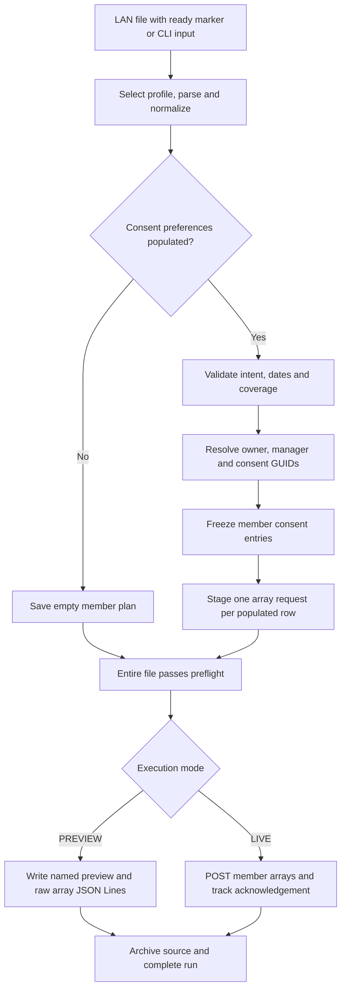
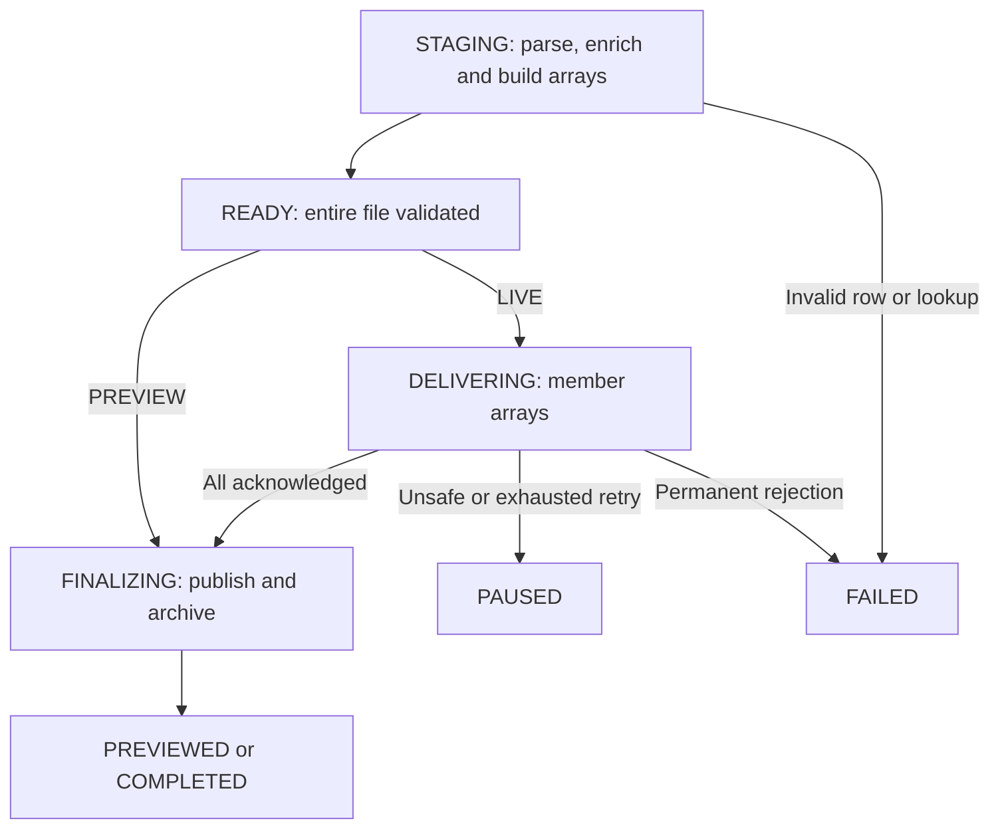

# CMS consent file adapter: developer walkthrough

This is the primary walkthrough for the development team. It explains the implemented application, shows where to change it, and provides a meeting/demo sequence. Keep this document current with the code. The [consent reference](consent.md) contains the complete 30-field disposition and integration assumptions; the [PowerPoint](presentations/File_Adapter_POC_Developer_Walkthrough.pptx) remains a presentation snapshot.

The application uses Java 17, Spring Boot, Gradle, Jackson and a local H2 processing ledger. It runs as a non-web worker. The current consent request model is **one POST per member row with populated preferences**, whose body is an array containing provider consent, payer consent, or both. There is at most one entry per consent target in that array. A row with both preferences blank produces no POST.

## Suggested team session

Allow about 45–60 minutes, including demos and discussion:

1. Establish the member-row and request-array model.
2. Follow intake, parsing, normalization, enrichment and assembly through the code.
3. Run the CSV fixture preview and inspect the output.
4. Repeat with another file format to show what the adapters isolate.
5. Exercise HTTP lookup, delivery and whole-array recovery against the local mock.
6. Agree on the remaining source, lookup and consent-service contracts.

## 1. The member row and the POST boundary

The input has 30 fields covering member identity, two consent preferences and their dates, and payer/subscriber information. Physical format does not determine business behavior: CSV, pipe, fixed width, XML and JSON feed the same planner.

| Provider preference | Payer preference | One row produces |
| --- | --- | --- |
| GRANT or RVOKE | Blank/null | One POST array with a PCDS entry |
| Blank/null | GRANT or RVOKE | One POST array with a P2PDS entry |
| GRANT or RVOKE | GRANT or RVOKE | One POST array with PCDS and P2PDS entries |
| Blank/null | Blank/null | No lookup and no POST |

A missing preference field is a layout error. A present blank/null preference means no change in this POC. Unknown populated preference codes fail validation. The example maps GRANT and RVOKE explicitly after trimming and normalizing case.

Provider precedes payer when both are included. The payer entry uses either the general shape or the coverage-specific shape. Those are alternatives: the application does not generate two P2PDS entries for one row.

When the feed supplies both preferences, both entries are included even if one matches the existing service state. The application does not infer which value changed. A feed that always supplies both values but intends only one change needs an agreed change indicator or comparison rule.

## 2. End-to-end flow



The application validates and stages the **whole file before any consent upsert**. An invalid later row blocks every consent POST from the file. Earlier rows may already have caused read-only member lookups, and their plans may already be stored locally.

The [full architecture](architecture.md) and [editable Mermaid source](architecture.mmd) include intake, delivery outcomes and the recovery ledger.

## 3. Code tour

Java paths below are relative to `src/main/java/com/jenbrick/fileadapter`.

| Open | Responsibility | What to discuss |
| --- | --- | --- |
| [application.yml](../src/main/resources/application.yml) | Active profiles and shared consent settings | Routing, layouts, code maps and environment variables |
| [FileAdapterApplication](../src/main/java/com/jenbrick/fileadapter/FileAdapterApplication.java) | Startup and one-shot commands | File processing, explicit resume and exit codes |
| [DirectoryPoller](../src/main/java/com/jenbrick/fileadapter/processing/DirectoryPoller.java) | Scheduled intake | Ready markers, minimum age and recovery |
| [ProfileCatalog](../src/main/java/com/jenbrick/fileadapter/config/ProfileCatalog.java) | Profile selection and validation | Exactly one matching filename profile or an explicit CLI selection |
| [FileFormatAdapter](../src/main/java/com/jenbrick/fileadapter/source/FileFormatAdapter.java) | Parser extension interface | Syntax and record boundaries |
| [SourceNormalizer](../src/main/java/com/jenbrick/fileadapter/source/SourceNormalizer.java) | Logical field selection | Aliases and JSON Pointer selectors |
| [ConsentRequestPlanner](../src/main/java/com/jenbrick/fileadapter/consent/ConsentRequestPlanner.java) | Consent business assembly | Intent, required data, lookup and nested entry objects |
| [MemberResolver](../src/main/java/com/jenbrick/fileadapter/consent/MemberResolver.java) | Company integration port | Actual member/manager/GUID resolution belongs here |
| [ConfiguredMemberResolver](../src/main/java/com/jenbrick/fileadapter/consent/ConfiguredMemberResolver.java) | Default resolver | Proposed HTTP facade protocol and synthetic fixtures |
| [ConsentPlanStore](../src/main/java/com/jenbrick/fileadapter/consent/ConsentPlanStore.java) | Frozen member plans | Reuse resolved values after interrupted staging |
| [FileProcessor](../src/main/java/com/jenbrick/fileadapter/processing/FileProcessor.java) | Run orchestration | Wrap each nonempty plan as one array, preflight, delivery and recovery |
| [ProcessingLedger](../src/main/java/com/jenbrick/fileadapter/processing/ProcessingLedger.java) | Durable run and request state | Payloads, source rows, attempts and acknowledgement |
| [PreviewWriter](../src/main/java/com/jenbrick/fileadapter/processing/PreviewWriter.java) | Preview exports | Source metadata and member-array origins |
| [HttpUpsertClient](../src/main/java/com/jenbrick/fileadapter/delivery/HttpUpsertClient.java) | HTTP transport | Jackson serialization, tokens, keys and response classification |

Generic employee profiles remain available. They use `ConfigurableRequestMapper` and `RequestValidator`; consent profiles use the explicit domain planner. This lets the application retain a generic mapping example while keeping consent business rules readable.

## 4. Intake and profile selection

The operating system mounts the LAN share. The worker reads a path accessible to its service account; it does not mount SMB shares or manage their credentials.

For polling, the producer finishes and closes the data file, then creates an empty sibling `<filename>.ready` marker. It must not change the data file after publishing that marker. The poller also checks minimum age. The worker copies the file to durable local storage and registers the run before removing a polled input and its marker. One-shot CLI input is copied and retained at its original location.

The supported deployment is one worker and one owner of the incoming directory, with persistent local work storage. A process lock protects that work directory. Separate workers with separate work directories must not race over the same incoming files.

Filename routing must select exactly one profile. For an arbitrarily named headed CSV, a one-shot command can select the profile explicitly:

```bash
java -jar build/libs/fileadapter-0.1.0.jar \
  --spring.profiles.active=consent-demo \
  --ingestion.profile-id=cms-consent-csv-v1 \
  --ingestion.file=/path/to/member-consents.csv
```

The default headed consent CSV pattern accepts `consent.csv` and `consent-header*.csv`. Change the patterns for the actual producer's naming scheme.

## 5. Adapter pattern and normalized representation

Each adapter implements `FileFormatAdapter`, owns its parser resources and emits `SourceRecord(number, payload)`. The payload is a Jackson `JsonNode`. Source record numbers identify logical records; a quoted CSV record can span physical lines.

| Adapter | Record boundary | Layout settings |
| --- | --- | --- |
| Delimited | CSV-aware record | Delimiter, header mode, or ordered headerless columns |
| Fixed width | Physical line | Exact length and zero-based Unicode code point ranges |
| XML | Selected element | Absolute record path and namespace aliases |
| JSON | Root object, array item, or line | Explicit OBJECT, ARRAY or LINES mode |

The supplied headerless layouts preserve the 30-field order. The fixed-width sample uses illustrative 544-character records, not a production specification. XML selects `/members/member`. JSON input array mode describes **input record boundaries**; it is separate from the array used as the **output POST body**.

`SourceNormalizer` can map physical columns or nested JSON Pointer paths to logical fields. Aliases present together must agree. Consent fields are strings or null so identifiers keep leading zeros. Do not put member lookups or consent business rules into a syntax parser.

See [formats](formats.md) for parser rules and [extensions](extensions.md) for new adapters and custom Java behavior.

## 6. Profiles and business settings

A consent profile selects the layout and references shared consent rules. This is an excerpt, not a complete external configuration file:

```yaml
id: cms-consent-csv-v1
filename-pattern: "consent{,-header*}.csv"
layout:
  format: DELIMITED
  charset: UTF-8
  delimiter: ","
  header-mode: FIRST_RECORD
consent:
  version: cms-consent-v2
  provider-target: PCDS
  payer-target: P2PDS
  preferences: { GRANT: GRANT, RVOKE: RVOKE }
  relationships: { SELF: SELF, SPOUSE: SPOUSE, DEPENDENT: DEPENDENT, OTHER: OTHER }
  date-pattern: uuuu-MM-dd
```

The full settings also define transaction metadata and lookup mode, endpoint, timeouts and fixtures. YAML anchors share the rules across consent layouts.

Spring replaces configuration lists instead of merging their elements. An external override must supply the complete `ingestion.profiles` list. Version meaningful business-rule changes and keep credentials in environment variables. Existing runs retain their original snapshots.

## 7. Member enrichment

Input `EXTERNAL_CONTRACT_ID` is external. It must not be copied into the internal contract property as a shortcut. `MemberResolver` returns:

- Owner internal contract, three-character PIN and opaque contract member GUID.
- An independently resolved consent manager identity, potentially a guardian or another member.
- Existing provider and payer consent GUIDs, or null for inserts, using the appropriate payer/policy scope.

The default HTTP implementation is a **proposed facade contract**, not an implementation of an already identified company API. Replace the resolver with the actual company integration, or implement the facade to compose the required database/API calls. Lookup operations must be read-only even though the proposed transport uses POST.

The resolver requires a unique valid resolution and HTTP 200 for the facade. Lookup errors fail preflight; the worker does not automatically retry those calls. Invalid or missing identities fail rather than falling back to guessed keys or assuming the manager is the owner. A PIN remains a string and can contain letters.

[The consent reference](consent.md#member-enrichment-integration) contains the complete lookup request and response examples. `CONSENT_LOOKUP_BEARER_TOKEN` and `UPSERT_BEARER_TOKEN` authenticate the two integrations separately and stay outside persisted snapshots.

## 8. Consent entries and the complete request

Common entry fields are consent GUID, target, status, owner, effective dates and transaction details. `transactionDetails` belongs inside each consent entry, alongside `coverage` when coverage exists. It contains source system, source timestamp, source transaction identifier and the resolved consent manager.

The planner uses a null consent GUID for inserts or the resolved existing GUID for updates. It emits an explicit null consent end date because the input has no dedicated consent end date. Payer policy effective/cancel dates do not become consent dates. Source dates use a strict configured input pattern and become ISO dates. A normal UTC source timestamp is captured once per completed member plan; the fixture demo fixes it for comparison.

The following is the actual combined POST body for synthetic sample member 1:

<!-- BEGIN combined-request-example -->
```json
[
  {
    "consentGuid": null,
    "consentTarget": "PCDS",
    "consentStatus": "RVOKE",
    "consentOwner": {
      "contract": "990000001",
      "pin": "001",
      "contractMemberGuid": "SYN-MEMBER-1"
    },
    "effectiveDate": "2026-10-01",
    "effectiveEndDate": null,
    "transactionDetails": {
      "sourceSystem": "MDB",
      "sourceDateTime": "2026-10-27T12:00:00Z",
      "sourceTransactionIdentifier": "synthetic.demo",
      "consentManager": {
        "contract": "990000001",
        "pin": "001",
        "contractMemberGuid": "SYN-MEMBER-1"
      }
    }
  },
  {
    "consentGuid": "SYN-CONSENT-20001",
    "consentTarget": "P2PDS",
    "consentStatus": "GRANT",
    "consentOwner": {
      "contract": "990000001",
      "pin": "001",
      "contractMemberGuid": "SYN-MEMBER-1"
    },
    "effectiveDate": "2026-10-02",
    "effectiveEndDate": null,
    "transactionDetails": {
      "sourceSystem": "MDB",
      "sourceDateTime": "2026-10-27T12:00:00Z",
      "sourceTransactionIdentifier": "synthetic.demo",
      "consentManager": {
        "contract": "990000001",
        "pin": "001",
        "contractMemberGuid": "SYN-MEMBER-1"
      }
    },
    "coverage": {
      "payerId": "SYN-PAYER",
      "otherPayerMemberId": "SYN-POL-1001",
      "groupNumber": "SYN-GRP-01",
      "policyHolderFirstName": "Alex",
      "policyHolderLastName": "Example",
      "policyHolderMiddleName": "Q",
      "policyHolderGender": "F",
      "policyHolderDateOfBirth": "1980-01-02",
      "relationshipToPolicyHolder": "SELF"
    }
  }
]
```
<!-- END combined-request-example -->

A provider-only or payer-only body is still an array, with one entry. Complete examples are available as [provider-only](../examples/consent/expected-provider-request.json), [payer with coverage](../examples/consent/expected-payer-request.json) and [general payer without coverage](../examples/consent/expected-payer-general-request.json).

Coverage is present when at least one mapped payer/subscriber coverage field is nonblank. That shape requires payer ID, policy ID and a translated relationship. Partial coverage fails validation. If every mapped coverage field is blank/null, the planner emits one general P2PDS entry without coverage. Payer name, address, plan type and policy dates currently have no approved target paths and remain in the retained source. See the [full field disposition](consent.md#field-disposition).

## 9. Whole-file preflight and frozen plans

For each member row, the planner validates intent and applicable fields, resolves identities, assembles consent entries and persists the completed plan in H2. An empty plan records a no-change row. A nonempty plan becomes exactly one staged array request.

| Persisted object | Key | Stored information |
| --- | --- | --- |
| Run snapshot | Run ID | Profile, rules, mode and delivery settings, excluding tokens |
| Member plan | Run ID + source record number | Zero, one or two frozen entry objects, including resolved identities and timestamps |
| Delivery request | Run ID + request number | Complete member array, source row, status and attempts |

If staging is interrupted, saved member plans are reused. A crash before a plan is saved may repeat its read-only lookup. Once a run is READY, delivery and resume use saved array bodies and never look members up again.

A later malformed date, unknown preference, incomplete coverage or unresolved member blocks every consent upsert from the file. A valid file containing only no-change rows succeeds with zero requests. Empty/header-only input fails.

## 10. Run identity, acknowledgement and recovery

Run identity is SHA-256 over input content hash plus the canonical snapshot. Filename is excluded. Identical content and settings deduplicate within the retained local ledger. Changing content or settings creates a different run; changing only remote lookup data does not.

Request keys use `<run-id>:<request-number>`. A two-entry member array has one request number, one key and one acknowledgement. The worker persists SENDING before making the network call.

| Upsert result | Outcome | Handling |
| --- | --- | --- |
| Configured success, default 200/201/204 | ACKNOWLEDGED | Skip this member array on future recovery |
| Other 2xx, including 202 by default | UNCERTAIN | Apply replay-safety policy |
| 408, 429, 5xx | RETRYABLE | Apply replay-safety policy |
| Other HTTP status | REJECTED | Fail the run |
| Transport error or timeout | UNCERTAIN | Apply replay-safety policy |

Default replay safety is false. A header alone does not create idempotency. When the service guarantees safe replay, the worker can retry the **same complete array** with the same key and body. Previously acknowledged member arrays are skipped. It does not separately retry a provider or payer entry.

One HTTP POST does not establish service-side transaction atomicity. An agreed success status must mean all entries completed. If the service returns per-entry outcomes, that response protocol must be implemented. A partial server-side commit followed by timeout needs whole-request idempotency or service-supported reconciliation.



Resume uses saved mode, endpoint, payloads and retry settings, with current runtime credentials. Unsafe uncertain requests remain paused even with explicit resume. FAILED runs are not resumed; correct the input/configuration and submit a new run. After correcting a transient lookup failure for identical input, deliberately bump the rule version to create a new run, as described in the [consent reference](consent.md).

New consent runs use engine version 3 and rules version `cms-consent-v2`. Historical version 2 previews remain readable. Unfinished version 2 LIVE runs pause before any legacy split-object POST; reconcile previous effects and submit a new array run. The worker does not silently regroup old in-flight requests.

## 11. Preview traceability

The named preview is `var-consent-demo/preview/<run-id>/<source-file>.preview.json` in the fixture demo. It contains:

| Property | Meaning |
| --- | --- |
| `source` | Filename, format, profile, run identity, request count and layout details |
| `source.requestBodyShape` | MEMBER_CONSENT_ARRAY for the current consent model |
| `source.engineVersion`, `source.consentRuleVersion` | Processing and business-rule versions |
| `requests` | Actual POST bodies: each element is itself a member array |
| `requestDetails` | Corresponding request number, source row, consentTargets and consentEntryCount |

For example, `requests[0]` contains both entries for sample member 1. The outer preview document is for inspection, not submission. The adjacent `requests.jsonl` contains one complete array POST body per line.

The five-row fixture produces four POST bodies and six consent entries. The fifth row is a no-op. Historical and current previews can coexist under different run IDs, so inspect the logged run directory and version metadata when comparing results.

## 12. Build and run the CSV preview in Git Bash

Run from the repository root with a JDK available through `JAVA_HOME` and `PATH`:

```bash
java -version
javac -version
./gradlew test bootJar

java -jar build/libs/fileadapter-0.1.0.jar \
  --spring.profiles.active=consent-demo \
  --ingestion.file=examples/consent/consent.csv
```

The initial Java runtime must already be installed. Gradle can provision the compiler toolchain when needed, subject to approved network access. `JAVA_HOME` points to the JDK installation root, not its `bin` directory. The built artifact remains `build/libs/fileadapter-0.1.0.jar` even if the clone folder is named `file-adapter-poc`.

`consent-demo` disables polling, uses PREVIEW, selects synthetic fixtures, fixes transaction metadata and writes to `var-consent-demo`. This demo makes no HTTP calls. Ordinary consent PREVIEW can call HTTP member lookup, but it never posts consent upserts. LIVE refuses fixture lookup.

Inspect the run ID in the log, then open its named preview and `requests.jsonl`. Compare the bodies with [expected-requests.jsonl](../examples/consent/expected-requests.jsonl) and the origins with [expected-request-details.json](../examples/consent/expected-request-details.json).

## 13. Repeat with other formats

```bash
for file in consent.csv consent-noheader.csv consent-header.psv consent-noheader.psv \
            consent.fw consent.xml consent-array.json consent.jsonl consent-object.json; do
  java -jar build/libs/fileadapter-0.1.0.jar \
    --spring.profiles.active=consent-demo \
    --ingestion.file="examples/consent/$file" || break
done
```

All five-member examples produce the same four array bodies. `consent-object.json` contains one member and produces one two-entry array.

To demonstrate the alternative general payer shape:

```bash
java -jar build/libs/fileadapter-0.1.0.jar \
  --spring.profiles.active=consent-demo \
  --ingestion.file=examples/consent/consent-object-payer-general.json
```

That example produces one array containing one P2PDS entry without coverage. The [example generator](../scripts/generate_consent_examples.py) regenerates the synthetic fixtures and expected outputs. Python is optional for the Java worker and fixture preview.

## 14. HTTP lookup and delivery demo

Start the loopback-only synthetic server in terminal 1:

```bash
python scripts/mock_consent_services.py
```

In terminal 2, use a fresh work directory and omit the fixture Spring profile:

```bash
export CONSENT_LOOKUP_URL='http://127.0.0.1:8082/members/resolve'
export UPSERT_URL='http://127.0.0.1:8082/consents/upsert'
export CONSENT_SOURCE_TRANSACTION='synthetic.demo'
export CONSENT_SOURCE_DATETIME='2026-10-27T12:00:00Z'

java -jar build/libs/fileadapter-0.1.0.jar \
  --ingestion.file=examples/consent/consent.csv \
  --ingestion.work-directory=./var-consent-walkthrough-live \
  --ingestion.mode=LIVE --ingestion.poll-enabled=false
```

The mock resolves synthetic members and captures accepted array requests in `var-consent-mock/received.jsonl`. It is a demo receiver, not the company service or a complete schema validator. Its idempotency memory lasts only until that Python process exits.

## 15. Whole-array retry demo

Stop the previous mock, then start a new one in terminal 1:

```bash
python scripts/mock_consent_services.py --fail-once-target P2PDS
```

In terminal 2, retain the environment variables from the HTTP demo and select another fresh work directory:

```bash
java -jar build/libs/fileadapter-0.1.0.jar \
  --ingestion.file=examples/consent/consent.csv \
  --ingestion.work-directory=./var-consent-walkthrough-retry \
  --ingestion.mode=LIVE --ingestion.poll-enabled=false \
  --ingestion.delivery.replay-safe=true \
  --ingestion.delivery.max-attempts=1
```

The first member array contains both targets. The mock returns 503 before accepting it, and the worker pauses. Keep the same mock running and resume with the logged run ID:

```bash
java -jar build/libs/fileadapter-0.1.0.jar \
  --ingestion.work-directory=./var-consent-walkthrough-retry \
  --ingestion.resume=RUN_ID --ingestion.poll-enabled=false
```

The retry sends the original complete two-entry array with the same key, then delivers the remaining member arrays. Automated tests also cover skipping earlier acknowledged members. Enable replay safety against a real service only when its owners guarantee the required behavior.

For a preflight-failure exercise, work with a copy of the input and introduce an invalid later consent date. Select the headed CSV profile explicitly if its filename does not match. Inspect the error report: it identifies the source row, and no consent POST occurs. Read-only lookups for earlier valid rows may already have happened.

## 16. Where new discoveries belong

| Discovery or requested change | Change here |
| --- | --- |
| Different header or nested source field | Layout field selectors and aliases |
| New headerless order or fixed-width ranges | Layout columns/ranges |
| Different file syntax | Format identifier, layout validation and FileFormatAdapter implementation |
| New source preference or relationship codes | Explicit consent code maps |
| Different input date format, target codes or metadata | Consent settings and environment |
| Actual company lookup APIs/database calls | MemberResolver implementation or facade |
| New consent/coverage structures or business rules | ConsentRequestPlanner and expected-body fixtures |
| Per-entry result or asynchronous completion protocol | Delivery client and acknowledgement/reconciliation model |
| Multiple source rows combined into one business entity | Explicit assembler with agreed grouping and conflict rules |

Do not bury domain joins or remote calls in a CSV adapter or scalar transform. Keep changes compatible with saved runs, and plan versions/migrations when semantics change. See [extensions](extensions.md).

## 17. Validation and operational boundaries

The implementation baseline at [f8a260e](https://github.com/jenbrick/fileadapter/commit/f8a260efbe927cbeb9c2e938bc52bc058687a12c) passed 103 tests. Those cover all consent layouts, expected array bodies, no-change rows, general payer shape, identity/date/code checks, full-file preflight, stable whole-array retry bodies/keys, skipped acknowledged members, no repeated delivery-time lookups and legacy LIVE protection. Packaged preview and HTTP retry/resume demos were also verified at that baseline.

Useful test entry points:

- [ConsentPreviewIntegrationTest](../src/test/java/com/jenbrick/fileadapter/ConsentPreviewIntegrationTest.java)
- [ConsentLiveIntegrationTest](../src/test/java/com/jenbrick/fileadapter/ConsentLiveIntegrationTest.java)
- [ConsentRulesTest](../src/test/java/com/jenbrick/fileadapter/consent/ConsentRulesTest.java)
- [LiveIntegrationTest](../src/test/java/com/jenbrick/fileadapter/LiveIntegrationTest.java) for the generic delivery safeguards

Local H2 provides durable single-worker state. It does not establish a cross-system exactly-once transaction. Define storage capacity, access, retention, backups, monitoring and reconciliation ownership. Inputs, plans, previews and captures can contain member data; logs and error reports omit raw source values and HTTP bodies. The shared repository examples are synthetic.

## 18. Decisions to close with the team

| Area | Decision |
| --- | --- |
| Producer contract | Actual filenames, encoding, layout, date formats and ready-marker ownership |
| Intent | Source codes, blank semantics and how a full-state row indicates a change |
| Identity | Unique owner match, manager authorization and existing consent GUID lookup |
| Payer scope | General versus coverage-specific lookup scope and required coverage fields |
| Owner shape | Whether the coverage-specific owner should omit PIN |
| Dates and other payer fields | Consent end-date semantics and approved paths for currently unmapped fields |
| Service response | Whether success acknowledges every entry, array atomicity, item outcomes and asynchronous status |
| Replay and concurrency | Whole-request idempotency, business uniqueness, stale GUID handling and reconciliation |

The array request envelope and at most one payer entry per row are confirmed. The actual company lookup contracts and remaining schema/response rules still need agreement. The [consent reference](consent.md) is the detailed field and integration companion to this walkthrough.
