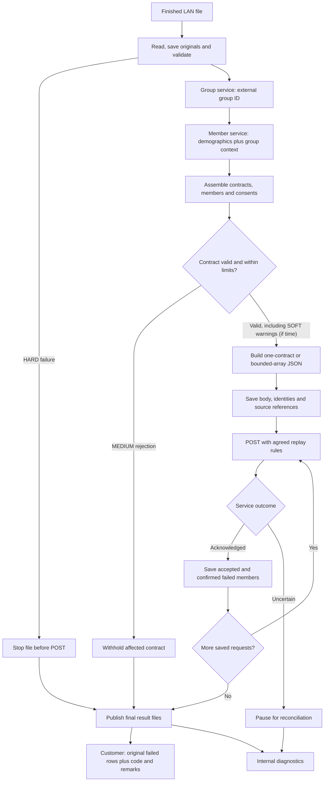

# January Delivery Plan Detailed

The [January diagrams](january-release-diagrams-v2.md) show the proposed classes, successful flow and error paths. Optional items are marked for discussion. This plan describes what to build for January; the POC already demonstrates more than that.

## 1. Give each part a clear job

| Part | What it does | POC starting point |
| --- | --- | --- |
| Intake worker | Wait for a finished file, copy it into working storage and identify the run | `FileProcessor` / `DirectoryPoller` |
| File adapter | Read file syntax and keep the original records | `FileFormatAdapter` implementations |
| Normalization | Translate producer field names into consistent internal fields | `SourceNormalizer` |
| Group lookup | Turn external group ID into internal group number/customer ID | `GroupEnricher` / `GroupResolver` |
| Member lookup | Use demographics/identifiers and group information to find member identity | `ConsentMemberEnricher` / `MemberResolver` |
| Consent assembly | Gather contracts/members and their consent/payer information | `PreparationCoordinator` / projection examples |
| JSON builder | Create the agreed field names, nesting and overall request format | POC `ProjectionEngine`; small Jackson builders are the proposed January alternative |
| Delivery | Enforce request limits, send HTTP, record acceptance and handle agreed safe retries | `UpsertClient` / `HttpUpsertClient` |
| Results | Write original-record customer results and detailed IT findings | `ResultStore` / `SourceResultWriter` / `ResultPublisher` |

Use one internal way to organize contracts, members and consents. Build the outgoing JSON separately: one builder for a contract object and, if included, another for an array of contracts. A setting selects the agreed format.

If the service adds or moves a JSON field, change the builder. Reading files and calling group/member services should not need to change with it.

## 2. What to include and how to check it

| Capability | January scope | How we know it works |
| --- | --- | --- |
| Intake | One worker and a finished-file signal for the LAN folder | A file still being written is left alone. |
| Formats | CSV only; add other formats later when needed | Test realistic quoting, blanks and malformed rows. |
| Original records | Save source values and record references before changing them | Customer results contain original fields, not enriched consent JSON. |
| Group lookup | Connect to the company dncgrp service | Send only external group ID. Missing group context prevents member lookup. |
| Member lookup | Connect to the dmqmbr demographics service | Send only demographics/identifiers and resolved group context. |
| Contract assembly | Gather a contract’s records from anywhere in the file | Repeats do not duplicate identical consents/coverages; conflicts are flagged. |
| Payer data | Follow the consent identity and coverage rules in the technical design | Payer records belong to the correct member and consent. |
| JSON format | Start with one complete contract; discuss whether arrays are also in January | Review sample JSON against the receiving upsert service’s agreed schema. |
| Limits per service call | Set agreed limits for contracts, members, coverages and total data size | Oversized work is flagged. Members/payer data are not silently split or omitted. |
| Errors | HARD stops the file. Confirm MEDIUM contract versus member rejection. SOFT is optional if time allows. | Other eligible work continues where the agreed rules permit. |
| Service results | Match returned contract/member identifiers to original rows | A reliably identified rejected member returns only that member’s submitted rows. |
| Support | Logs, counts, result-file locations and a short support guide | Support can find a run, affected records, outgoing request and whether it succeeded, failed or needs attention. |

The POC saves H2 on disk, so state survives restart. H2 may be enough for January; agree storage with the deployment team and revisit it later if needed.

Start with one process. Several processes would need extra work to prevent them from claiming the same files/contracts.

Start with one complete contract per request. If arrays are included, use the same assembly and delivery flow with a maximum number of contracts. A contract that is too large must be rejected or handled through a separately agreed splitting rule. Never silently leave out members or payer information.

## 3. Follow the processing flow

The diagram shows the main steps rather than every error. Follow the group/member services’ agreed rules. If group lookup fails, do not call member lookup. Save MEDIUM rejections while continuing with eligible contracts. Publish the final customer result once outcomes are known. Record SOFT warnings for IT if warnings are included.

Save progress as we go, not just before POST. Keep original records, successful group results for the run and completed member lookups where practical. Save the exact request body before sending it. The POC has separate saved checkpoints for these steps.

## 4. Agree on how the receiving service works

Settle these with the receiving-service team early:

| Topic | What we need to know |
| --- | --- |
| Consent identity | What distinguishes one consent from another, including several payer consents for one member? Where does an existing consent GUID come from? |
| Coverage changes | Add to existing coverage, replace it, or send explicit add/remove instructions? Does an empty list mean remove everything or leave it alone? |
| Partial success | Does one failure reject the request, contract, member or consent? |
| Finding failed rows | Which returned identifiers let us find original records? Member GUID alone cannot identify one of several coverage rows. |
| Completion | What means the changes are saved, rather than just received? |
| Retry | How does the service prevent duplicates? How do we check a request when its response is lost? |
| Limits | How many contracts, members and coverages, and how many bytes, can one request contain? |
| JSON | Which structure and date formats are accepted? How do we express no change or revocation? |
| Consent manager | How do we identify someone acting for a different member? |

Review realistic request/response examples together. Agree the initial JSON format early. Keep service-specific calls and JSON-building code separate so changes stay manageable.

## 5. Write error files and preserve successful work

| Situation | What the adapter does | Customer return | DBS IT report |
| --- | --- | --- | --- |
| HARD preparation failure | Stop before sending consent updates | Original records with code/remarks if a complete return can be made | Why the file failed and affected records |
| MEDIUM contract failure, if this is the agreed rule | Skip that contract; continue others | That contract’s original rows with code/remarks | Cause and rejected contract |
| SOFT warning, if included | Continue | Warning rows only if agreed | Warning and affected records |
| Service confirms a member failure | Keep confirmed successes and record the rejection | That member’s submitted original rows | Request, member identity and source references |
| Uncertain send/result | Hold for review or safely retry under the agreed rules | No final claim that unresolved rows failed | What is uncertain and what needs checking |

Assume UCD gets the **same format it sent**, with code and remarks added. Agree their names and positions. Fixed-width widths would need agreement if that format is added later.

If the file cannot be read completely, retain it for review. Do not return the readable prefix as if it were the whole file.

The adapter writes the files. We still need to define the outside process for customer delivery and DBS IT email. Use agreed business wording for customer remarks. DBS IT can receive more technical detail, excluding credentials and sensitive response content.

Discuss how we handle a later stop after LIVE sending begins. It cannot undo earlier accepted requests. Keep those successes recorded and never return them as failed just because a later request failed.

## 6. Demonstrate the complete flow

Use synthetic data with several contracts, several members per contract and rows for the same contract scattered through the file.

1. Include provider-only, payer-only and combined changes.
2. Include several payer consents/coverages for one member.
3. Make one contract invalid. Add a nonblocking warning if warnings are included.
4. Send valid work using the agreed JSON format and limits.
5. Check the original failed rows with code/remarks and the DBS IT report.
6. Have a compatible test service reject one member. Check other members according to its partial-success rules.
7. If restart is included, stop after one request succeeds and prove it is not sent again.
8. If uncertain-result recovery is included, lose a response and prove we can check the result or safely resend the same body/key.

Also test unreadable input, ambiguous member matches, incomplete group results, oversized requests and failed result-file writes.

Measure representative files and document January’s supported limit. We may not have a partner file by then, so state which synthetic sizes were tested and which real-feed assumptions still need confirmation.

## 7. Leave these for later

- Several workers processing files together.
- A configuration UI or a general mapping language.
- Unlimited-size files or combining unrelated files.
- Customer transmission or IT email inside the adapter.
- General scheduling or advanced dashboards.

Judge January against the agreed input, service behavior, complete-flow tests and support needs. The POC demonstrates other possibilities.

POC references: [code walkthrough](developer-walkthrough-v2.md), [group/member lookup](group-member-lookups-v2.md), [contract grouping](contract-batching-v2.md), [error handling](error-handling-v2.md) and [runtime diagrams](runtime-diagrams-v2.md).
