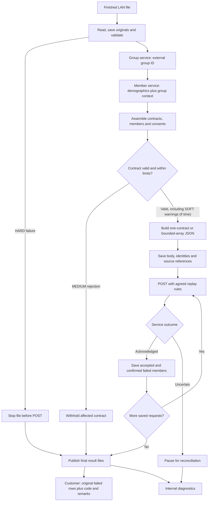

# January Delivery Plan Detailed

See the [January release class and sequence diagrams](january-release-diagrams.md) for the proposed classes, happy path, and error paths; optional scope remains marked for discussion.

## 1. Proposed boundaries

| Component | Owns | POC reference |
| --- | --- | --- |
| Intake worker | Finished-file detection, local staging and run identity | FileProcessor / DirectoryPoller |
| File adapter | Physical syntax and original-record capture | FileFormatAdapter implementations |
| Normalization | Producer names → consistent internal fields | SourceNormalizer |
| Group lookup | External group ID → internal group number/customer ID | GroupEnricher / GroupResolver |
| Member lookup | Member demographics/identifiers plus group context → member identity | ConsentMemberEnricher / MemberResolver |
| Consent assembler | Contract/member grouping, consent decisions and payer collections | PreparationCoordinator / projection examples |
| Payload builder | Agreed JSON field names, nesting and root wrapper | ProjectionEngine demonstrates configuration; small Jackson builders are the proposed initial production alternative |
| Delivery | Request limits, HTTP handling, acknowledgement and safe retry | UpsertClient / HttpUpsertClient |
| Results | Original-record customer returns and detailed IT diagnostics | ResultStore / SourceResultWriter / ResultPublisher |

Organize the contract, member, and consent data the same way inside the application. Then use two small pieces of code to create the JSON: one for sending a single contract and one for sending several contracts together. A setting determines which format to use.

If the receiving service needs a field added or moved, update the code that creates the JSON. The code that reads the files and calls the group and member services should stay the same.

## 2. First-release scope and acceptance

| Capability | Initial scope | Acceptance check |
| --- | --- | --- |
| Intake | One worker and a finished-file protocol for the configured LAN folder | A file still being written is not processed. |
| Formats | CSV only; other formats only when they become needed in a future release | Read representative files, including quotes, blanks and malformed records. |
| Original records | Retain source values and source-record references before normalization | Customer returns contain the original fields, not enriched consent JSON. |
| Group lookup | Update to our existing company group service (dncgrp endpoint) | Only external group ID is sent; incomplete group context should prevent member lookup. |
| Member lookup | Update to our demographics service (dmqmbr endpoint) | The request contains only member demographics/identifiers and resolved group context. |
| Contract assembly | Bring together all records for a contract and its members, even when they appear in different parts of the file. | Repeated information does not create duplicate consents or payer coverage records. Conflicting information is flagged. |
| Payer data | Support the agreed consent identity and coverage collection rules (see Tech Design Doc) | Multiple payer records are associated with the correct member and consent. |
| JSON candidates | Discussion needed --> Support sending one contract at a time or several contracts together, up to a configured limit. ? | Reviewed examples against the dmqmbr upsert service endpoints - should match the candidate service json schema |
| Limits per Service Call | Configure/Set limits on the number of contracts, members and payer coverage records, and the total amount of data sent in one call. | If a contract or group of contracts is too large, flag for handling rather than splitting its members or payer information across calls without an agreed rule. |
| Error scope | HARD file stop, MEDIUM contract rejection, SOFT warning (if we have time to do SOFT warning) | Other valid contracts continue when rules permit. |
| Service results | Use the contract number and member GUID returned by the service to match failures to the original file records. | When the service identifies a failed member, return only that member’s submitted records in the customer error file. |
| Support and Troubleshooting | Write logs, show processing counts and error-file locations, and provide a short guide for support. | Support can find a processing run, see which records were affected and what was sent, and determine whether processing succeeded, failed or needs attention. |

The POC uses an H2 database saved on disk, so processing status survives a restart. For production, we may want to choose another form of storage. We may be okay with H2 for January and then opt for a database or other alternative later down the road.

Start with one process handling files. If we later need several processes running at once, we’ll need a way to assign work so they don’t process the same files or contracts twice.

Start with one complete contract per request. Implement the bounded array option through the same assembler and delivery path. A contract that exceeds the agreed limits needs explicit rejection or a separately agreed split protocol; do not silently omit members or payer data.

## 3. Detailed processing flow

The diagram focuses on boundaries rather than every exception. Group/member lookup errors follow the current services contracts, and a group failure prevents that member call. MEDIUM rejections accumulate while other contracts continue; publish the final customer return when the run’s outcomes are known. SOFT warnings remain visible in the IT report (if time).

Persistence happens throughout intake and lookup as well as before POST. Save successful group context for the run and completed member resolutions where practical, then save the exact outgoing body before the network side effect. The POC shows these as separate checkpoints.

## 4. Resolve the receiving-service contract early

| Decision | What must be agreed |
| --- | --- |
| Consent identity | What distinguishes provider and payer consents, including multiple payer consents for one member? How are existing consent GUIDs obtained? |
| Coverage updates | Does the request merge coverage, replace the collection, or use explicit add/remove operations? What does an empty collection mean? |
| Partial success | Is processing atomic by request, contract, member or consent? Can accepted work coexist with failed members? |
| Failure correlation | Which stable contract/member identifiers are returned? A member GUID cannot identify one particular coverage row without another key. |
| Acknowledgement | Which HTTP statuses and response fields mean processing has completed? |
| Replay | Does the service honor an idempotency key, and how does it handle the same key/body on retry? How is an uncertain result reconciled? |
| Limits | What are the contract, member, coverage and serialized-byte limits? |
| Representation | Which wrapper is accepted initially, what are the date/timestamp rules, and how are no-change and revocation represented? |
| Consent manager | How is the manager identified when it differs from the member? |

The member-demographics service should not be expected to resolve a particular payer-consent GUID from demographics alone. If the upsert requires that GUID, agree on a separate consent-identity lookup or an endpoint rule that makes it unnecessary.

Use realistic request/response fixtures to settle these decisions. Agree on a stable launch shape early; keep endpoint changes localized in the service adapters and payload builders.

## 5. Error files and partial results

| Situation | Processing | Customer return | IT report |
| --- | --- | --- | --- |
| HARD preparation error | No upsert for the file | Original parsed records with code/remarks when a complete return can be produced | File-level failure and affected source references |
| MEDIUM contract error | Exclude that contract; continue others | Original rows belonging to the rejected contract | Triggering error and contract scope |
| SOFT warning | Continue | Include only if the agreed return policy requests warnings | Always retain the warning |
| Confirmed service member failure | Preserve confirmed successes according to service semantics | That member’s submitted original rows | Request, contract/member identity and source references |
| Uncertain send/result | Pause or retry only under the agreed replay contract | Do not invent member failures or publish an unresolved return as final | Operational hold and reconciliation details |

The customer file is in the incoming format and appends code/remarks. For fixed width, agree on the appended widths. For XML/JSON, preserve original record structure and add the fields. A malformed file may prevent a complete source-format return; retain the original and require review rather than pretending a parsed prefix is the whole file.

An outside process handles customer transmission and IT email. Customer remarks should be approved business text; IT diagnostics can be more detailed without exposing credentials or blindly copying response bodies.

A later LIVE hard failure cannot roll back requests already acknowledged by the service. Record those successes accurately and stop/reconcile the remaining work. Never return already accepted rows as failed simply because a later batch failed.

## 6. Acceptance scenario

Use synthetic records representing several contracts and multiple members per contract. Put some rows for the same contract in different parts of the file.

1. Include provider-only, payer-only and combined consent changes.
2. Include multiple payer coverages and, if the agreed API allows them, multiple distinct payer consents for a member.
3. Make one contract invalid and add a nonblocking warning to another.
4. Deliver valid contracts and verify the agreed one-contract/bounded-array behavior.
5. Return the correct original failed records with code/remarks; retain every diagnostic finding for IT.
6. Have a compatible test endpoint reject a specific member and verify the other members are handled according to its partial-success contract.
7. Interrupt delivery after one request is acknowledged. Restart and prove that it is not sent again.
8. Simulate a lost response and demonstrate reconciliation or safe idempotent replay with the same body/key.

Also test malformed input, ambiguous member matching, incomplete group context, request limits and output-file write failure. Use measured representative file sizes; the initial design must have a documented supported limit.

## 7. Defer from the first release

- Multiple workers and distributed claiming.
- A configuration-management UI or a general transformation language.
- Unlimited-file streaming or arbitrary joins across files.
- Automatic email/customer delivery inside the adapter application.
- Generalized scheduling and advanced operational dashboards.

The POC provides examples of many capabilities. The initial production implementation should be judged against the agreed launch feeds, service contracts, acceptance scenario and support needs.

Relevant POC guides: [code walkthrough](developer-walkthrough.md), [group/member lookup](group-member-lookups.md), [contract batching](contract-batching.md), [error/result handling](error-handling.md), and [implemented runtime diagrams](runtime-diagrams.md).
