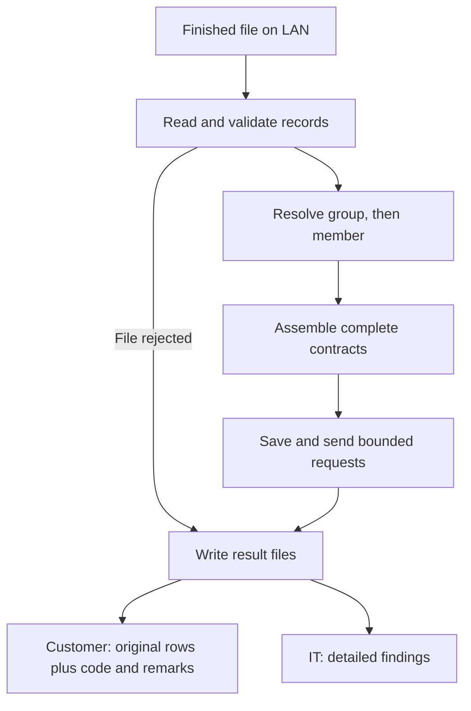

# January Delivery Plan Overview

> V2: plain-English copy. [Original for comparison](january-delivery-plan-overview.md). Commands, configuration examples and diagrams are unchanged.
**Goal:** build a small, complete flow that reads a file, sends consent updates and gives us enough information to support it.

Use the POC to show the proposed architecture and reuse what fits. Keep January focused on CSV and the service behavior we can agree on. We may not have a partner feed or final service contracts by then, so use representative examples and write down the assumptions.

The [January diagrams](january-release-diagrams-v2.md) show the proposed classes, the successful flow and the error paths. They also mark the features we still need to discuss.

## What we build first

| Part | What it does |
| --- | --- |
| Receive files | One worker watches configured LAN folders and waits until the producer says the file is finished. |
| Read records | Read CSV. Add other formats later when a feed needs them. |
| Find the group and member | Send the external group ID to the group service. Use the returned internal group number and customer ID to look up the member’s contract number, PIN and member GUID. |
| Gather consent information | Bring together a contract’s members and their provider/payer consents. Allow multiple payer consents and coverages where required. |
| Send JSON | Start with one complete contract per request. Discuss whether January also needs several contracts per request, with a configured maximum. Use the same preparation and sending code for either choice. |
| Write results | UCD gets the original failed records with code and remarks in the input format. DBS IT gets a separate report with all errors and any warnings we implement. |
| Save progress | Save the exact request and its status. Keep track of work the service has accepted. Discuss how much restart and uncertain-result handling we can include. |

The member lookup gets only member demographics/identifiers and the group information. Keep consent preferences, payer data and the outgoing consent JSON out of that call.

## How the pieces fit together

The result folders hold files for another process to send. The adapter does not send customer files or email IT. The [detailed plan](january-delivery-plan-detailed-v2.md) covers the processing and support details.

## What happens when something goes wrong

| Type | What happens |
| --- | --- |
| HARD | If preparation finds a file-stopping error, stop before sending any consent updates. |
| MEDIUM | Decide whether we reject the whole affected contract or only a member we can identify reliably. Continue with other eligible work. |
| SOFT | If included in January, record the warning and continue. |
| Service rejects a member | Return only that member’s submitted original records when the response gives us enough information to identify them. |

Once the service has accepted a request, a later failure cannot undo it. Keep those earlier successes recorded.

## Keep the JSON-building code small

Organize the data internally by contract, member and consent. Use a small JSON builder for one contract. If several contracts per request are included, add a second builder for that format.

Keep the outgoing field names and nesting in the builders. If the receiving service changes its JSON, we should be able to update the builder without changing the file reader or member lookup.

The POC also shows how YAML can control the JSON mapping. Reuse that if it helps, but we do not need to build a general mapping language for January. The receiving-service team still needs to agree to whichever JSON format we use.

Leave multiple workers, a configuration screen, arbitrary transformations, unlimited-size files, automatic email and a general scheduling system for later.

## What we should demonstrate

Process a file with several contracts, several members per contract and repeated payer records. Make one contract invalid. Add a warning if warnings are included. Send the valid work, return the correct original failed records and write the DBS IT report.

If restart is included, stop after a request succeeds and prove that restarting does not send it again.

This is the proposed January scope. The [POC walkthrough](developer-walkthrough-v2.md) explains what the current code already demonstrates.
