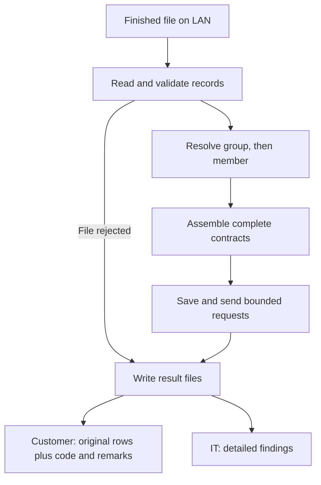

# January Delivery Plan Overview

**Goal:** deliver a small, complete file-to-consent flow that we can operate and support.

Reference the POC for the proposed the architecture and reuse the parts that fit. Keep the release focused on the feeds needed at launch (if any) and the agreed service contracts (which we probably won't have). 

## What we build first

| Part | Initial implementation |
| --- | --- |
| Receive files | One worker, configured LAN folders, and a signal that the producer has finished writing. |
| Read records | CSV using one adapter. Add other formats when a feed requires them in the future. |
| Resolve identities | External group ID → group service → internal group number/customer ID → member demographics service → contract/PIN/member GUID. |
| Build consent data | Keep members together under their contract. Support provider consent, payer consent, or both, with multiple payer consents and coverages where required. |
| Send JSON | Initially, send one contract at a time, including all its members and their consent information. Scope Discussion --> Also allow several contracts to be sent together, up to a configured limit, using the same code to send the request.|
| Report results | Customer (UCD): original failed records plus code/remarks in the incoming format. DBS IT: all hard, medium and soft findings in a separate report. |
| Recover safely | Save the exact request and its status. Skip acknowledged work. Scope Discussion --> Reconcile uncertain sends before replaying them. |

The member service receives member demographics/identifiers plus resolved group context. Consent preferences, payer/coverage data and the consent upsert body stay out of that lookup.

## Simple architecture

The result folders are outboxes. Another process sends customer files and emails IT. The [January Delivery Plan Detailed](january-delivery-plan-detailed.md) expands validation, error isolation and recovery.

## Error rules

| Type | What happens |
| --- | --- |
| HARD | Stop the file before sending when found during preparation. |
| MEDIUM | Discussion --> Reject the affected contract and continue with other contracts <OR> reject only a single member ? |
| SOFT | Scope Discussion --> Record a warning and continue. |
| Confirmed service member rejection | Return only that member’s submitted original rows when the response identifies the member reliably. |

After delivery starts, ensure a later hard stop can't undo earlier acknowledged requests. 

## Keep output mapping small

For the January release, organize the data by contract, member, and consent. Use two small pieces of code to create the JSON: one for sending a single contract, and one for sending several contracts together, up to a configured limit.

Keep the JSON field names and structure in those two places. If the receiving service changes its required format, we can update that code without changing how we read files or look up members.

The POC’s configurable YAML projection engine demonstrates another option. You can reuse it if it fits, but building a general mapping language isn't a requirement for the release. The candidate JSON wrappers still need agreement with the receiving service.

**Defer:** parallel workers, a configuration UI, arbitrary transformations, unlimited-file streaming, automatic email and generalized scheduling.

## The acceptance demo

Process a file with multiple contracts, multiple members, repeated payer rows, one bad contract (and maybe one warning if time and if applicable). Deliver the valid contracts, return the correct original failed records, and produce the DBS IT report. 
If time --> Interrupt processing and demonstrate restart without resending acknowledged requests. 

This overview describes the proposed initial production scope. See the [POC walkthrough](developer-walkthrough.md) for what the current code already demonstrates.
