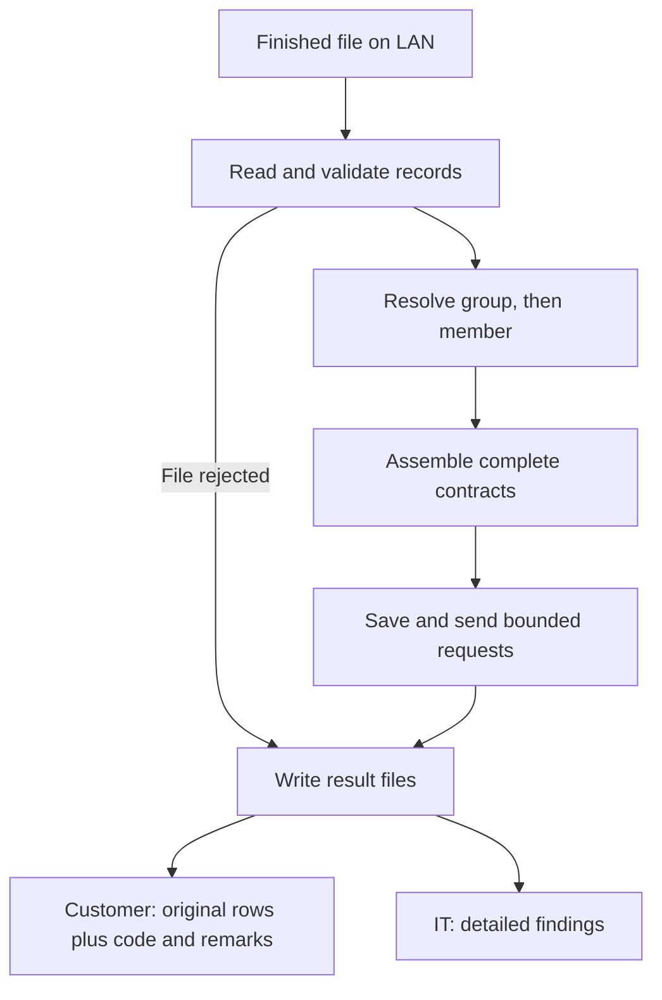

# January Delivery Plan Overview

**Goal:** deliver a small, complete file-to-consent flow that the team can operate and support.

Use the POC to explain the architecture and reuse the parts that fit. Keep the first release focused on the feeds needed at launch and the agreed service contracts. The four-week plan is a proposed sequence; its feasibility depends on team capacity and service availability.

## What we build first

| Part | Initial implementation |
| --- | --- |
| Receive files | One worker, configured LAN folders, and a signal that the producer has finished writing. |
| Read records | CSV and other required delimited files using one adapter. Add other formats when a launch feed requires them. |
| Resolve identities | External group ID → group service → internal group number/customer ID → member demographics service → contract/PIN/member GUID. |
| Build consent data | Keep members together under their contract. Support provider consent, payer consent, or both, with multiple payer consents and coverages where required. |
| Send JSON | Start with one complete contract per request. Keep the bounded array-of-contracts option behind the same delivery interface. |
| Report results | Customer: original failed records plus code/remarks in the incoming format. IT: all hard, medium and soft findings in a separate report. |
| Recover safely | Save the exact request and its status. Skip acknowledged work; reconcile uncertain sends before replaying them. |

The member service receives member demographics/identifiers plus resolved group context. Consent preferences, payer/coverage data and the consent upsert body stay out of that lookup.

## Simple architecture

The result folders are outboxes. Another process sends customer files and emails IT. The [January Delivery Plan Detailed](january-delivery-plan-detailed.md) expands validation, error isolation and recovery.

## Error rules

| Type | What happens |
| --- | --- |
| HARD | Stop the file before sending when found during preparation. |
| MEDIUM | Reject the affected contract and continue with other contracts. |
| SOFT | Record a warning and continue. |
| Confirmed service member rejection | Return only that member’s submitted original rows when the response identifies the member reliably. |

After delivery starts, a later hard stop cannot undo earlier acknowledged requests. Uncertain service outcomes need reconciliation; they are not proof that a member failed.

## Keep output mapping small

For the initial release, use a clear internal contract/member/consent model and two small Jackson payload builders: one contract object, or a bounded array of contract objects. Keep field names and nesting inside those builders so endpoint changes stay localized.

The POC’s configurable YAML projection engine demonstrates another option. The team can reuse it if it fits, but building a general mapping language is not a prerequisite for this release. The candidate JSON wrappers still need agreement with the receiving service.

## Four-week sequence

| Week | Working outcome |
| --- | --- |
| 1 | A real CSV reaches the group and member services and produces reviewed consent JSON. |
| 2 | Contract assembly, the two payload candidates, bounded requests and test-endpoint delivery work end to end. |
| 3 | Error isolation, customer/IT files, persisted status and controlled restart work. |
| 4 | Acceptance tests, remaining required formats, deployment and support instructions are complete. |

Start the service-contract decisions in week 1: consent identity, coverage merge/replace rules, member-level results, request limits and safe retries. Test representative files throughout the month.

**Defer:** parallel workers, a configuration UI, arbitrary transformations, unlimited-file streaming, automatic email and generalized scheduling.

## The acceptance demo

Process a file with multiple contracts, multiple members, repeated payer rows, one bad contract and one warning. Deliver the valid contracts, return the correct original failed records, and produce the IT report. Interrupt processing and demonstrate restart without resending acknowledged requests. Use a compatible test service to demonstrate a member-only rejection as well.

This overview describes the proposed initial production scope. See the [POC walkthrough](developer-walkthrough.md) for what the current code already demonstrates.
