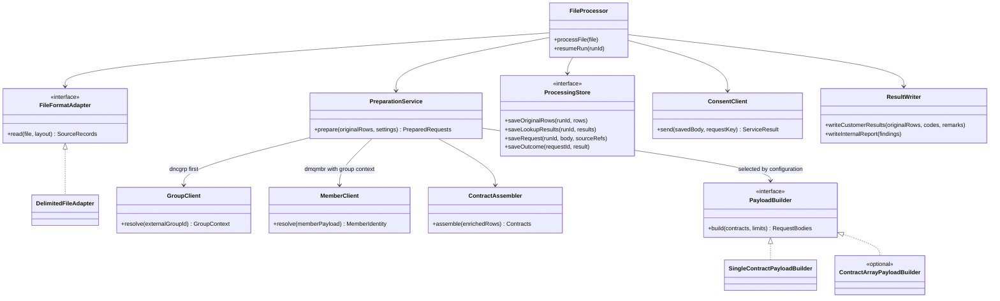
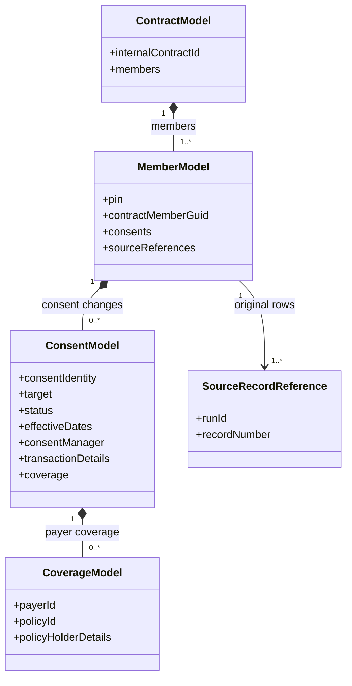

# January Release: Class and Sequence Diagrams

These diagrams show the proposed January design from the [overview](january-delivery-plan-overview-v2.md) and [detailed plan](january-delivery-plan-detailed-v2.md). The class names describe jobs we need the code to do. They do not mean these exact classes already exist.

January starts with CSV. `GroupClient` calls dncgrp, and `MemberClient` calls dmqmbr. We still need to decide whether January includes several contracts per request, SOFT warnings, MEDIUM rejection by contract or member, and how much automatic recovery. Those options are marked in the diagrams.

Start with the application classes and successful sequence for the team discussion. Use the data model and error sequence for the implementation details. Related service clients share a participant in the sequences to keep the drawings readable; group lookup still happens before member lookup. The [runtime diagrams](runtime-diagrams-v2.md) show the current POC instead.

## Application classes

`FileProcessor` coordinates a run. `PreparationService` puts input fields into a consistent form, checks records, looks up groups/members, gathers contracts and chooses the JSON builder. `ProcessingStore` saves progress in the storage we agree to use. Keeping `FileFormatAdapter` separate from `PayloadBuilder` lets us change file reading without changing JSON construction.

Use `DelimitedFileAdapter` for January CSV. Other formats can be added later. `ResultWriter` writes UCD’s original failed records with code/remarks and the separate DBS IT report. Another process sends the files or email.



Editable diagram: [january-release-classes.mmd](diagrams/january-release-classes.mmd).

## How we organize data inside the application

This model organizes contracts, members, consents and coverages in the code. **It is not the JSON format sent to the service.** The builder turns this data into the field names and structure the receiving service accepts.

A member can have several consents, including distinct payer consents if supported. A payer consent can have several coverages. Source references point back to saved original records so we can return the right rows when something fails.



Editable diagram: [january-release-data-model.mmd](diagrams/january-release-data-model.mmd).

## Sequence: everything succeeds

This assumes valid records, complete group/member lookup results, accepted consent requests and successful result-file writes. It shows LIVE delivery. PREVIEW writes the JSON without the consent POSTs. There are no error branches in this sequence.

```mermaid
sequenceDiagram
    autonumber
    participant P as FileProcessor
    participant F as File adapter
    participant L as Group and member clients
    participant S as ProcessingStore
    participant C as Consent service
    Note over P,C: Happy path only: valid file, complete lookups, accepted requests and successful result publication
    P->>F: Read finished CSV and validate its layout
    F-->>P: Original records and source record numbers
    P->>S: Save run settings and original records
    loop Each member row that requests a consent change
        P->>L: Resolve external group ID through dncgrp
        L-->>P: Internal group number and customer ID
        P->>S: Save group context for this run and group
        Note over L,S: Reuse saved group context for later rows in the same group
        P->>L: Resolve member through dmqmbr using member-only payload plus group context
        L-->>P: Internal contract, PIN and member GUID
        P->>S: Save completed member lookup and source references
    end
    P->>P: ContractAssembler gathers members, consents and coverages
    P->>P: Select configured PayloadBuilder and enforce request limits
    Note over P,S: Start with one contract per body; the limited multi-contract option remains a scope decision
    P->>S: Save all prepared JSON bodies, request keys and source references
    loop Each saved request in order
        P->>S: Record send attempt before calling the service
        P->>C: POST saved JSON with agreed request key
        C-->>P: Confirm processing completed and all submitted members accepted
        P->>S: Save acknowledgement
    end
    P->>P: ResultWriter writes IT completion report and configured customer results
    Note over P,S: Failed-record-only customer output has no rows on this happy path
    P->>P: Publish ready manifests and archive the original file
    P->>S: Mark run completed
```

Editable diagram: [january-release-sequence-happy.mmd](diagrams/january-release-sequence-happy.mmd).

## Sequence: errors and recovery

This adds file stops, contract/member rejection options, optional warnings, uncertain sends and result-file failures. Optional branches are things to discuss, not promises for January.

Return a member’s rows as failed only when a complete, agreed service response reliably identifies that member. If we do not know what happened, pause for investigation rather than guessing.

```mermaid
sequenceDiagram
    autonumber
    participant P as FileProcessor
    participant A as PreparationService
    participant S as ProcessingStore
    participant E as Group, member and consent services
    participant R as ResultWriter
    P->>S: Save run and available original records
    P->>A: Read and validate the complete input
    break HARD file or parsing failure
        A-->>P: File cannot proceed
        P->>S: Save HARD findings and failed-file status
        P->>R: Write IT report and eligible original-record return
        Note over P,R: No consent POST; incomplete parsed input is not published as a complete customer return
    end
    loop Each contract being prepared
        P->>A: Validate and resolve its member rows
        A->>S: Look for saved group context for this run
        S-->>A: Saved context or no previous resolution
        opt Group context is not already saved
            A->>E: dncgrp lookup with external group ID only
            E-->>A: Complete group context or lookup failure
        end
        alt Group resolution failed or incomplete
            Note over A,E: Do not call the member service for this failed lookup
        else Group context available
            A->>S: Save newly resolved internal group number and customer ID
            A->>E: dmqmbr lookup with member-only payload plus group context
            E-->>A: Member identity or lookup failure
        end
        alt HARD lookup or contract policy
            A-->>P: File-level failure
            P->>S: Save HARD findings
            P->>R: Write failure results
            break Stop this file before delivery
                Note over P,E: No consent POST for this file
            end
        else MEDIUM contract rejection, if this boundary is selected
            A-->>P: Reject this complete contract
            P->>S: Save findings and all affected original row references
            Note over P,S: Continue preparing the other contracts
        else MEDIUM member rejection, if selected and reliably identified
            A-->>P: Reject only the identified member
            P->>S: Save that member's affected original row references
            Note over P,S: Retain other members only under the agreed partial-contract rules
        else SOFT warning, if included in January scope
            A-->>P: Contract remains eligible, with warning
            P->>S: Save warning without rejecting the contract
        else Valid contract
            A-->>P: Contract ready for JSON assembly
        end
    end
    P->>A: Build one-contract requests from eligible data under the agreed error policy
    A-->>P: JSON bodies within agreed limits; multi-contract arrays are optional scope
    P->>S: Save all request bodies, stable keys and source references
    Note over P,S: Any remaining HARD preparation error stops delivery; an empty eligible set produces no POST
    loop Each saved request that is not already acknowledged
        loop Attempt same request until acknowledged, rejected or paused
        P->>S: Record attempt before POST
        P->>E: Send saved JSON and agreed request key
        alt All submitted members accepted
            E-->>P: Confirmed completed success
            P->>S: Save acknowledgement
        else Confirmed member or contract rejection with usable IDs
            E-->>P: Complete results identify accepted and failed work
            P->>S: Save acknowledgement and scoped outcomes together
            Note over P,R: Member rejection selects that member's submitted rows; contract rejection selects that contract's rows
        else Known permanent request rejection or HARD service stop
            E-->>P: Confirmed rejection
            P->>S: Save failure and stop remaining requests
            P->>R: Write failure results, excluding earlier accepted rows
            break Stop further delivery
                Note over P,E: Earlier acknowledgements cannot be rolled back
            end
        else Timeout, lost response or temporary transport failure
            E-->>P: Request outcome is not confirmed
            P->>S: Save uncertain or retryable outcome
            alt Automatic replay is included, agreed safe, and attempts remain
                P->>P: Wait before the next permitted attempt
                Note over P,E: Next attempt uses the same saved body and key; remain on this request until its outcome is resolved
            else Replay is unsafe or retry limit is reached
                P->>S: Pause run for reconciliation
                P->>R: Write internal hold report
                break Await reconciliation
                    Note over P,R: No final customer rejection is inferred from an uncertain send
                end
            end
        else Incomplete response, unknown IDs or unrecognized result codes
            E-->>P: Results cannot be matched reliably
            P->>S: Preserve outcome and pause for reconciliation
            P->>R: Write internal hold report
            break Await a reliable decision
                Note over P,R: Do not guess which member failed or resend acknowledged work
            end
        end
        end
    end
    P->>S: Save finalizing status
    P->>R: Publish customer and IT result files
    alt Result files written successfully
        R-->>P: Ready manifests point to completed files
        P->>S: Mark completed or completed with rejections
    else Result-file write failure
        R-->>P: Output is not ready
        P->>S: Keep recoverable finalization state
        Note over P,R: Retry result publication after repair; do not repeat acknowledged consent POSTs
    end
```

Editable diagram: [january-release-sequence-errors.mmd](diagrams/january-release-sequence-errors.mmd).

## What we still need to agree on

- Look up the external group ID first. Send the returned internal group number/customer ID with the member demographics request. Keep consent and payer data out of that lookup.
- Prepare and check eligible work before sending. HARD stops the file during preparation. Decide whether MEDIUM rejects a whole contract or a reliably identified member, and whether SOFT warnings fit January. Member-only rejection needs agreed partial-processing rules.
- Start with one complete contract per request. Several contracts per request, up to a configured limit, remain optional. The receiving service must accept the JSON format. Do not split a contract or silently leave out members/coverage to make it fit. Excluding a rejected member also needs an agreed rule.
- Save originals, lookup progress, request bodies, keys and results. If restart is included, skip already acknowledged requests and restore their saved member/contract findings.
- Agree on how the response reports member/contract results. HTTP success alone does not tell us how partial success works or whether the whole request is treated as one transaction.
- Investigate uncertain sends. Automatic retry/reconciliation is still a scope decision and needs a duplicate-safe agreement with the service. Any allowed retry uses the same saved body/key; resolve or pause that request before moving on.
- Customer results use affected original records with code/remarks in the input format. DBS IT gets all recorded errors and any warnings included. Publish only complete, eligible result files through ready manifests. Sending/email is handled outside the adapter.
- Keep earlier accepted work recorded when a later request fails. Unreadable input, unknown outcomes and incomplete customer returns need review.

Multiple workers, a configuration UI, a general mapping language and unlimited-size streaming are outside this initial design. Confirm storage, service behavior and supported limits with the deployment and service teams.

## Where to start in the POC

| Proposed job | Current POC starting point |
| --- | --- |
| Prepare the data: `PreparationService` | `PreparationCoordinator`, `SourceNormalizer` and the lookup chain |
| Call services: `GroupClient` / `MemberClient` | `GroupResolver` / `MemberResolver` and their adapters |
| Gather contracts and build JSON: `ContractAssembler` / `PayloadBuilder` | Grouping and JSON examples in `ProjectionEngine`; January can use smaller typed builders |
| Send consent requests: `ConsentClient` | `UpsertClient` / `HttpUpsertClient` |
| Save progress: `ProcessingStore` | `ProcessingLedger` and saved source, lookup and result state |
| Write result files: `ResultWriter` | `ResultPublisher` / `SourceResultWriter` |

These names describe responsibilities. We do not need to rename existing classes or replace tested adapters just to match the diagram.
