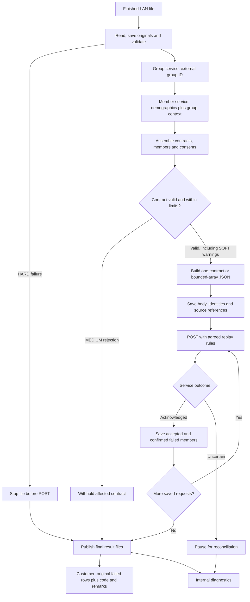

# Month-one delivery plan: implementation detail

**Build one complete, supportable flow first.** Use the [simple overview](month-one-overview.md) to present the scope, then use this document to divide the work and agree on acceptance criteria.

This is a proposed first-release plan, not a claim that the POC is production-ready or that the company service contracts are already implemented. Four weeks assumes the team has access to those services, representative files, a test environment and prompt decisions on unresolved behavior. Confirm capacity and required launch feeds before committing to the schedule.

## 1. Agree on the boundaries

Keep these responsibilities separate:

| Component | Owns | POC reference |
| --- | --- | --- |
| Intake worker | Finished-file detection, local staging and run identity | FileProcessor / DirectoryPoller |
| File adapter | Physical syntax and original-record capture | FileFormatAdapter implementations |
| Normalization | Producer names → consistent internal fields | SourceNormalizer |
| Group lookup | External group ID → internal group number/customer ID | GroupEnricher / GroupResolver |
| Member lookup | Member demographics/identifiers plus group context → member identity | ConsentMemberEnricher / MemberResolver |
| Consent assembler | Contract/member grouping, consent decisions and payer collections | PreparationCoordinator / projection examples |
| Payload builder | Agreed JSON field names, nesting and root wrapper | ProjectionEngine demonstrates configuration; small Jackson builders are the proposed initial production alternative |
| Delivery | Request limits, HTTP handling, acknowledgement and safe retry | UpsertClient / HttpUpsertClient |
| Results | Original-record customer returns and detailed IT diagnostics | ResultStore / SourceResultWriter / ResultPublisher |

For output, use one internal model and two payload builders. Keep the business assembly separate from whether the HTTP body is a contract object or an array of contract objects. Configuration can select the agreed flavor. Adding or moving an output property should affect the payload builder, rather than the parser or lookup clients.

This recommendation simplifies the first production implementation. It does not require replacing the POC’s configurable projection engine before showing the architecture to the developers. Reuse that engine only if the team decides its extra flexibility is worth maintaining.

## 2. First-release scope and acceptance

| Capability | Initial scope | Acceptance check |
| --- | --- | --- |
| Intake | One worker and a finished-file protocol for the configured LAN folder | A file still being written is not processed. |
| Formats | CSV and required delimiter variants; other formats only where required at launch | Read representative files, including quotes, blanks and malformed records. |
| Original records | Retain source values and source-record references before normalization | Customer returns contain the original fields, not enriched consent JSON. |
| Group lookup | Adapt the existing company group service | Only external group ID is sent; incomplete context prevents member lookup. |
| Member lookup | Adapt the company demographics service | The request contains only member demographics/identifiers and resolved group context. |
| Contract assembly | Gather nonadjacent rows for a contract and its members | Repeated rows do not duplicate identical consents or coverages; conflicting values are detected. |
| Payer data | Support the agreed consent identity and coverage collection rules | Multiple payer records are associated with the correct member and consent. |
| JSON candidates | A single-contract object and a bounded array of contract objects | Reviewed examples match the candidate schemas; production enables an accepted contract. |
| Limits | Configure contracts/request and agreed member, coverage or payload-size limits | Oversized work is handled explicitly; complete contracts are not silently split. |
| Error scope | HARD file stop, MEDIUM contract rejection, SOFT warning | Other valid contracts continue when policy permits. |
| Service results | Correlate confirmed contract/member failures using stable identities | A known failed member returns only that member’s submitted source rows. |
| Result handoff | Separate customer and IT outboxes with completed-file/ready signaling | An outside sender can distinguish complete results, previews and incomplete/uncertain work. |
| Persistence | Use approved persistent storage and an inspectable run/request status model | Restart does not resend acknowledged work or rebuild a different request for an uncertain attempt. |
| Operations | Logs, basic counts, error locations and a short runbook | Support can find the run, affected records, submitted request and current disposition. |

Use file-backed H2 for the local POC. Choose the company-approved storage for production with the deployment team. Keep the first implementation single-worker; shared/distributed claiming is separate work.

Start with one complete contract per request. Implement the bounded array option through the same assembler and delivery path. A contract that exceeds the agreed limits needs explicit rejection or a separately agreed split protocol; do not silently omit members or payer data.

## 3. Detailed processing flow

The diagram focuses on boundaries rather than every exception. Group/member lookup errors follow the agreed file/contract policy, and a group failure prevents that member call. MEDIUM rejections accumulate while other contracts continue; publish the final customer return when the run’s outcomes are known. SOFT warnings remain visible in the IT report.

Persistence happens throughout intake and lookup as well as before POST. Save successful group context for the run and completed member resolutions where practical, then save the exact outgoing body before the network side effect. The POC shows these as separate checkpoints.

## 4. Resolve the receiving-service contract early

| Decision | What must be agreed |
| --- | --- |
| Consent identity | What distinguishes provider and payer consents, including multiple payer consents for one member? How are existing consent GUIDs obtained? |
| Coverage updates | Does the request merge coverage, replace the collection, or use explicit add/remove operations? What does an empty collection mean? |
| Partial success | Is processing atomic by request, contract, member or consent? Can accepted work coexist with failed members? |
| Failure correlation | Which stable contract/member identifiers are returned? A member GUID cannot identify one particular coverage row without another key. |
| Acknowledgement | Which HTTP statuses and response fields mean processing has completed? |
| Replay | Does the service honor an idempotency key, and how does it handle the same key/body on retry? How is an uncertain result reconciled? |
| Limits | What are the contract, member, coverage and serialized-byte limits? |
| Representation | Which wrapper is accepted initially, what are the date/timestamp rules, and how are no-change and revocation represented? |
| Consent manager | How is the manager identified when it differs from the member? |

The member-demographics service should not be expected to resolve a particular payer-consent GUID from demographics alone. If the upsert requires that GUID, agree on a separate consent-identity lookup or an endpoint rule that makes it unnecessary.

Use realistic request/response fixtures to settle these decisions. Agree on a stable launch shape early; keep endpoint changes localized in the service adapters and payload builders.

## 5. Error files and partial results

| Situation | Processing | Customer return | IT report |
| --- | --- | --- | --- |
| HARD preparation error | No upsert for the file | Original parsed records with code/remarks when a complete return can be produced | File-level failure and affected source references |
| MEDIUM contract error | Exclude that contract; continue others | Original rows belonging to the rejected contract | Triggering error and contract scope |
| SOFT warning | Continue | Include only if the agreed return policy requests warnings | Always retain the warning |
| Confirmed service member failure | Preserve confirmed successes according to service semantics | That member’s submitted original rows | Request, contract/member identity and source references |
| Uncertain send/result | Pause or retry only under the agreed replay contract | Do not invent member failures or publish an unresolved return as final | Operational hold and reconciliation details |

The customer file is in the incoming format and appends code/remarks. For fixed width, agree on the appended widths. For XML/JSON, preserve original record structure and add the fields. A malformed file may prevent a complete source-format return; retain the original and require review rather than pretending a parsed prefix is the whole file.

An outside process handles customer transmission and IT email. Customer remarks should be approved business text; IT diagnostics can be more detailed without exposing credentials or blindly copying response bodies.

A later LIVE hard failure cannot roll back requests already acknowledged by the service. Record those successes accurately and stop/reconcile the remaining work. Never return already accepted rows as failed simply because a later batch failed.

## 6. Four-week delivery sequence

| Week | Main work | Exit condition |
| --- | --- | --- |
| 1 | Confirm required feeds and API contracts; wire intake, CSV, group and member lookup; draft the internal model and output fixtures | One representative file reaches real lookup services in the test environment and produces reviewed JSON. |
| 2 | Implement contract/member/consent assembly, repeated payer rows, payload builders, limits and endpoint delivery | The vertical flow reaches the test upsert endpoint using the agreed request shape; both candidate builders have fixture coverage. |
| 3 | Complete error isolation, same-format customer returns, IT diagnostics, durable status and controlled restart | Bad contracts and warnings have the right scope; acknowledged work is skipped during recovery. |
| 4 | Finish remaining required formats, realistic-volume/failure testing, acceptance, deployment and runbook | The acceptance scenario passes and support can diagnose/reconcile a run. |

Start tests, basic tracking and error handling with the first vertical slice. These weeks describe when capabilities are completed, not a reason to defer testing or persistence until the end. If an additional format is launch-critical, schedule it explicitly rather than leaving it as unplanned week-four work.

## 7. Acceptance scenario

Use synthetic records representing several contracts and multiple members per contract. Put some rows for the same contract in different parts of the file.

1. Include provider-only, payer-only and combined consent changes.
2. Include multiple payer coverages and, if the agreed API allows them, multiple distinct payer consents for a member.
3. Make one contract invalid and add a nonblocking warning to another.
4. Deliver valid contracts and verify the agreed one-contract/bounded-array behavior.
5. Return the correct original failed records with code/remarks; retain every diagnostic finding for IT.
6. Have a compatible test endpoint reject a specific member and verify the other members are handled according to its partial-success contract.
7. Interrupt delivery after one request is acknowledged. Restart and prove that it is not sent again.
8. Simulate a lost response and demonstrate reconciliation or safe idempotent replay with the same body/key.

Also test malformed input, ambiguous member matching, incomplete group context, request limits and output-file write failure. Use measured representative file sizes; the initial design must have a documented supported limit.

## 8. Defer from the first release

- Multiple workers and distributed claiming.
- A configuration-management UI or a general transformation language.
- Unlimited-file streaming or arbitrary joins across files.
- Automatic email/customer delivery inside the adapter application.
- Generalized scheduling and advanced operational dashboards.

The POC provides examples of many capabilities. The initial production implementation should be judged against the agreed launch feeds, service contracts, acceptance scenario and support needs.

Relevant POC guides: [code walkthrough](developer-walkthrough.md), [group/member lookup](group-member-lookups.md), [contract batching](contract-batching.md), [error/result handling](error-handling.md), and [implemented runtime diagrams](runtime-diagrams.md).
