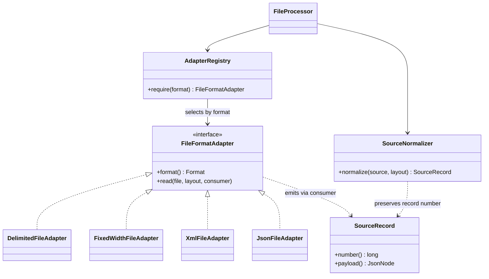
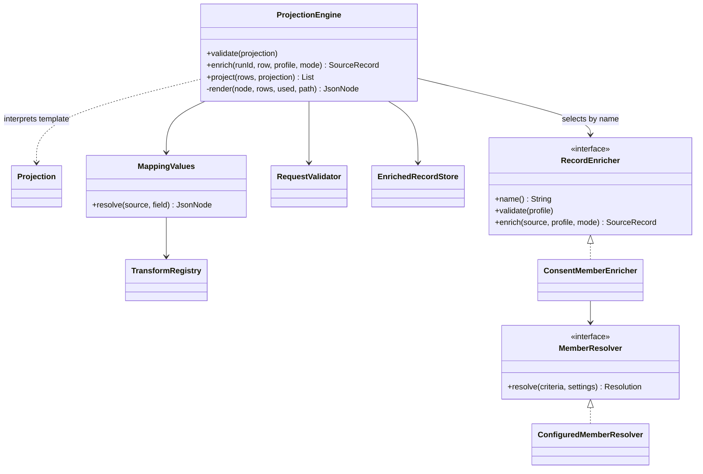
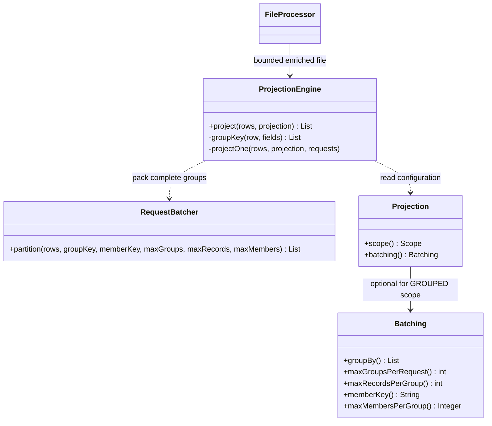

# Runtime sequence and class diagrams

These diagrams describe the flexible implementation, including the two bounded [contract batching](contract-batching.md) candidates. The happy path now follows GROUPED scope; FILE and RECORD remain alternate mapping scopes. “Projection” means the configured output mapping. See the [CSV debugger walkthrough](csv-debug-walkthrough.md) for breakpoints, sample values and runnable commands.

The simple sequence assumes a new run, valid input, LIVE with HTTP enrichment, successful preparation and an acknowledged POST. The combined collaborator labels keep that overview readable; they are not additional Java classes. The detailed sequences separate preparation from delivery so each stays within five participants. Class diagrams show selected real classes and dependencies, omitting framework infrastructure and most configuration records.

## Happy path: CSV to live POST

```mermaid
sequenceDiagram
    autonumber
    participant I as CLI or DirectoryPoller
    participant P as FileProcessor
    participant M as Adapters and ProjectionEngine
    participant L as Local stores
    participant H as HttpUpsertClient and endpoint
    I->>P: process(input, profileId, consume)
    P->>P: Resolve profile, copy input, hash and save snapshot
    P->>L: create run (STAGING)
    P->>M: read CSV, normalize and enrich each row
    M->>L: Save enriched rows
    P->>M: project(rows, GROUPED projection)
    M->>M: Gather whole contracts and enforce row/member caps
    M-->>P: Single-contract objects or bounded contract arrays
    P->>L: Stage each body with its source rows; status READY
    P->>L: status DELIVERING
    loop Each staged request
        P->>L: Mark request SENDING
        P->>H: post(saved body, runId:requestNumber, settings)
        H-->>P: ACKNOWLEDGED
        P->>L: Save request acknowledgement
    end
    P->>L: status FINALIZING
    P->>P: Archive input and snapshot
    P->>L: status COMPLETED
    P-->>I: runId
```

Editable source: [sequence-happy-path.mmd](diagrams/sequence-happy-path.mmd).

## Detailed sequence: intake, preparation and mode selection

```mermaid
sequenceDiagram
    autonumber
    participant I as CLI or DirectoryPoller
    participant P as FileProcessor
    participant M as Parsing and projection collaborators
    participant L as Local stores
    participant O as PreviewWriter or UpsertClient
    Note over I,P: Poller first calls recover(); waits for ready marker and minimum age
    I->>P: process(input, profileId, consume)
    alt Invalid input or no unique matching profile
        P-->>I: Throw intake exception
        Note over I,P: Poller quarantines remaining input for IllegalArgumentException; CLI exits 1
    else Intake accepted
        P->>P: Copy, checksum, derive ID from content and snapshot
        P->>L: Get run; create STAGING run if absent
        opt Poller consumes source
            P->>P: Delete ready marker, then incoming file
        end
        P->>P: execute(id, false)
        alt COMPLETED or PREVIEWED
            Note over P,O: Return success; recreate missing preview if needed
        else FAILED or PAUSED
            Note over P,L: FAILED returns false; PAUSED needs explicit resume
        else FINALIZING
            P->>P: finish() without parsing or sending
        else STAGING, READY or DELIVERING
            opt STAGING
                P->>P: Verify staged checksum
                P->>L: Clear partially staged requests
                loop Each data record
                    P->>M: read callback; normalize; enforce record limit
                    M->>M: Validate input contract
                    M->>L: Check saved enrichment by run and row
                    alt Saved enriched row exists
                        L-->>M: Reuse enriched payload
                    else Not yet saved
                        M->>M: Run configured enrichment and lookup
                        M->>L: Save enriched payload
                    end
                end
                P->>M: project using FILE, RECORD or GROUPED scope
                M->>M: GROUPED gathers contracts, checks caps and partitions requests
                alt Parse, lookup, limit, mapping, conflict or validation failure
                    M-->>P: Exception
                    P->>P: fail(PREFLIGHT); report; move processing files to errors
                    P->>L: FAILED
                    Note over P,O: Stop this run; no upsert is sent
                else Preparation succeeds
                    M-->>P: One contract or bounded contract arrays with source provenance
                    P->>L: Stage requests; READY
                end
            end
            Note over P,O: Continue only if preparation succeeded
            alt PREVIEW
                P->>O: write(run, snapshot)
                P->>L: FINALIZING
                P->>P: Archive; mark PREVIEWED
            else LIVE
                P->>L: DELIVERING; read staged requests in order
                loop Each request until failure or pause
                    alt Already ACKNOWLEDGED
                        Note over P,L: Skip this request
                    else Pending or previously attempted
                        P->>P: deliver(id, request, snapshot, manual)
                        Note over P,O: See delivery and retry sequence below
                        P->>O: Deliver saved body under replay policy
                        O-->>P: Outcome
                    end
                end
                opt Every request acknowledged or no requests generated
                    P->>L: FINALIZING
                    P->>P: Archive; mark COMPLETED
                end
            end
        end
    end
    Note over P,L: Recovery selects STAGING, READY, DELIVERING, FINALIZING; infrastructure errors may leave these recoverable
```

Editable source: [sequence-detailed.mmd](diagrams/sequence-detailed.mmd).

## Detailed sequence: HTTP outcomes, retries and resume

```mermaid
sequenceDiagram
    autonumber
    participant P as FileProcessor
    participant L as ProcessingLedger
    participant H as HttpUpsertClient
    participant S as Upsert endpoint
    Note over P,L: Each request is one contract or a bounded array; acknowledged earlier requests are skipped
    alt Request already REJECTED
        P->>P: fail(HTTP_REJECTED); stop
    else Prior attempt exists and replay-safe is false
        P->>P: pause(); reconciliation required
    else Attempt permitted
        loop While retry budget remains and no terminal outcome
            P->>L: sending() persists SENDING and increments attempts
            P->>H: post(saved JsonNode, runId:requestNumber, settings)
            H->>S: POST application/json with configured headers
            alt Configured success status (default 200, 201, 204)
                S-->>H: Acknowledgement status
                H-->>P: ACKNOWLEDGED
            else HTTP 408, 429 or 500 and above
                S-->>H: Retryable status
                H-->>P: RETRYABLE
            else Other 2xx or network ResourceAccessException
                H-->>P: UNCERTAIN
            else Other HTTP status
                S-->>H: Rejection status
                H-->>P: REJECTED
            end
            P->>L: result(outcome, httpStatus)
            alt ACKNOWLEDGED
                Note over P,L: Return success to delivery loop
            else REJECTED
                P->>P: fail(HTTP_REJECTED); stop run
            else Replay disabled
                P->>P: PAUSED; stop run
            else More attempts available
                P->>P: Exponential delay capped at 30 seconds
                Note over P,H: Retry same complete contract batch and same idempotency key
            else Budget exhausted
                P->>P: PAUSED; stop run
            end
        end
    end
    opt Explicit resume of a PAUSED run
        P->>L: Load saved snapshot and requests
        Note over P,L: Skip acknowledgements; no parsing or lookup for delivery-phase resume
        Note over P,H: Manual resume adds a retry budget; replay-safe false still blocks prior attempts
    end
```

Editable source: [sequence-delivery-recovery.mmd](diagrams/sequence-delivery-recovery.mmd).

## Class diagram: orchestration

```mermaid
classDiagram
    direction TB
    class FileAdapterApplication {
        +main(args)
    }
    class DirectoryPoller {
        +poll()
    }
    class FileProcessor {
        +process(input, profileId, consume) String
        +resume(id) boolean
        +recover()
        -execute(id, manual) boolean
        -deliver(id, request, snapshot, manual) boolean
        -finish(run, snapshot) boolean
    }
    class ProfileCatalog {
        +resolve(file, explicitId) Profile
    }
    class ProjectionEngine {
        +enrich(runId, row, profile, mode) SourceRecord
        +project(rows, projection) List
    }
    class ProcessingLedger
    class PreviewWriter
    class UpsertClient {
        <<interface>>
        +post(request, idempotencyKey, settings) DeliveryResult
    }
    class HttpUpsertClient
    FileAdapterApplication ..> FileProcessor : starts or resumes
    DirectoryPoller --> FileProcessor : polls and recovers
    FileProcessor --> ProfileCatalog
    FileProcessor --> ProjectionEngine
    FileProcessor --> ProcessingLedger
    FileProcessor --> PreviewWriter
    FileProcessor --> UpsertClient
    UpsertClient <|.. HttpUpsertClient
```



Editable source: [classes.mmd](diagrams/classes.mmd).

## Class diagram: adapter implementations



Editable source: [classes-adapters.mmd](diagrams/classes-adapters.mmd).

## Class diagram: mapping and enrichment



Editable source: [classes-projection.mmd](diagrams/classes-projection.mmd).

## Class diagram: request batching



Editable source: [classes-batching.mmd](diagrams/classes-batching.mmd).

`RequestBatcher` gathers nonadjacent groups and enforces indivisible group/member limits. It knows no consent JSON schema. `ProjectionEngine` renders each partition into the selected object/array template. The prepared bodies are staged independently and retried with their own keys. File preparation still completes before the first delivery.

## How to read the alternate paths

- Configuration validation happens during Spring startup, before file processing; invalid layouts, unknown enrichers and malformed templates can prevent startup.
- A preflight exception ends preparation for that run. The diagram’s later PREVIEW/LIVE branches apply only after successful preparation.
- HTTP outcome handling uses status codes. The client does not inspect individual consent results in a response body, so acknowledgement of a batch is not proof of per-consent atomicity.
- Recovery automatically considers `STAGING`, `READY`, `DELIVERING` and `FINALIZING`. `PAUSED` needs explicit resume; `FAILED` is not resumed. Completed runs are reused for identical content and snapshot.
- PREVIEW can perform HTTP lookups if configured. The default fixture demo performs neither lookup HTTP nor delivery HTTP. LIVE refuses fixture member enrichment.
- Local stores use file-backed H2. Snapshots preserve configuration, enriched rows and request JSON for repeatable recovery. A stable idempotency key requires an agreement with the receiving service to make replay safe.
